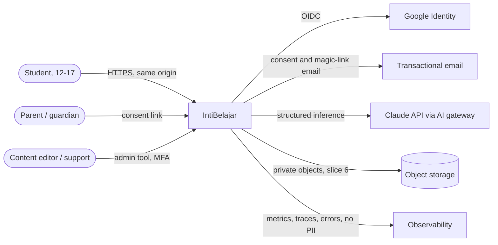
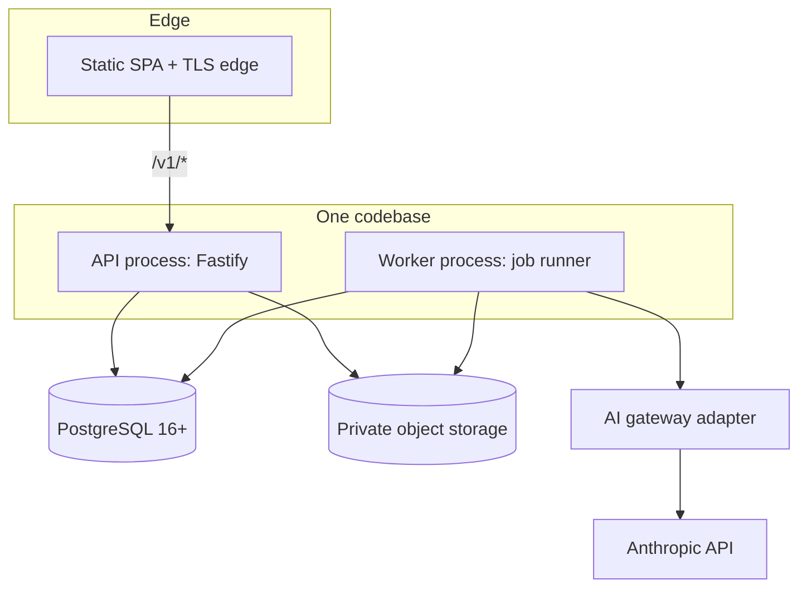

# 02 · System architecture

**Status: proposed v1. Nothing is deployed.** Decisions with alternatives are in [10](10-architecture-decisions.md).

## 1. Shape in one paragraph

IntiBelajar runs as a **TypeScript modular monolith**. One versioned codebase starts in two process roles: an **API** (Fastify, HTTP) and a **worker**, which takes jobs leased from PostgreSQL. **PostgreSQL is the single source of truth** for identity, consent, catalog, learning sessions, evidence, mastery and jobs. The Vue SPA is served from the same origin and remains a pure client of the HTTP API. AI and OCR sit behind a narrow **AI gateway** that only the worker calls; it has no database access. There is no Redis, Kafka, Kubernetes or microservice split in v1, and nothing in the audit justifies them ([10](10-architecture-decisions.md)).

## 2. Context



## 3. Containers and modules



Modules own their tables. They call each other only through typed in-process interfaces (commands and queries), never by writing another module's tables.

| Module | Owns (tables, see [04](04-postgresql-erd.md)) | Responsibilities |
|---|---|---|
| `identity` | `app_user`, `auth_identity`, `auth_session`, `auth_transaction` | OIDC/email sign-in, opaque sessions, CSRF tokens, logout |
| `privacy` | `learner`, `student_profile`, `guardian`, `consent_record`, `deletion_request`, `erasure_receipt`, `audit_event` | Age band, guardian consent lifecycle, purpose gates, deletion and erasure, audit trail |
| `catalog` | `curriculum_release`, `subject`, `topic`, `topic_relation`, `concept`, `concept_prerequisite`, `question`, `question_revision`, `question_concept`, `micro_lesson`, `micro_lesson_revision`, `lesson_concept`, `micro_assessment`, `catalog_alias` | Versioned publishing, public projections that never leak rubrics, alias manifest |
| `learning` | `learning_session`, `session_item`, `lesson_assignment`, `question_attempt`, `assistance_event` | State machine, command validation, attempts, hints, solution exposure, resume |
| `assessment` | `diagnosis_run`, `concept_evidence`, `diagnosis_report` | Deterministic evaluators, AI-assisted diagnosis orchestration, evidence validation and eligibility, learner disputes |
| `progress` | `mastery_state`, `progress_event`, `learner_stats` | Mastery policy projection, XP, streaks, missions, activity feed, legacy snapshot |
| `tutor` | `tutor_conversation`, `tutor_message` | Contextual hints, hint ladder, solution-review gate |
| `intake` | `question_intake`, `private_asset` | Upload, OCR draft, confirmation into a private question |
| `platform` | `idempotency_record`, `job`, `ai_invocation`, `budget_counter` | Idempotency, job leasing, AI cost ledger, budgets and rate limits |

Dependency rule: the domain modules (`learning`, `assessment`, `progress`) depend on `catalog` and `privacy` interfaces. `assessment` may append evidence. Only `progress` derives mastery. **The AI gateway is a leaf with no database access.** It returns candidate outputs, and `assessment` decides what they mean.

## 4. Deterministic rules vs probabilistic inference

| Concern | Owner | Deterministic? |
|---|---|---|
| Who may act, on which resource, with which consent | `identity`, `privacy` | Yes |
| Which state transitions are legal | `learning` | Yes |
| Grading of options, numeric answers and authored forms (accepted spellings, values such as `20√3 ≈ 34,64`) | `assessment` evaluators | Yes |
| Interpreting free-text working against solution paths | AI gateway (proposal) → `assessment` validation | **No.** The model proposes, rules validate. |
| Whether evidence is eligible for mastery | `assessment` eligibility rules | Yes |
| Mastery status, XP, streaks | `progress` policy | Yes, replayable |
| Tutor wording | AI gateway with output filters | No, bounded by policy |

An AI output can never by itself move a learner forward, award credit or change mastery ([06](06-diagnosis-evidence-mastery.md), [07](07-ai-integration.md)).

## 5. Two canonical flows

### 5.1 Submit an answer (command → asynchronous diagnosis)

```mermaid
sequenceDiagram
  autonumber
  participant SPA
  participant API
  participant DB as PostgreSQL
  participant W as Worker
  participant GW as AI gateway
  SPA->>API: POST /v1/learning-sessions/{id}/attempts (Idempotency-Key, expectedStateVersion)
  API->>DB: BEGIN; claim idempotency key; lock session; check state and version
  API->>DB: INSERT attempt, diagnosis_run(QUEUED), job; session -> DIAGNOSING; COMMIT
  API-->>SPA: 201 {attempt, diagnosisRun(status=QUEUED), session} + Retry-After
  W->>DB: lease job (FOR UPDATE SKIP LOCKED)
  alt deterministic rubric covers the response
    W->>W: evaluate locally (no AI)
  else free-text needs interpretation
    W->>GW: inferDiagnosis(context ids, redacted response)
    GW-->>W: candidate JSON + usage
  end
  W->>DB: BEGIN; re-check lease, generation, session state; INSERT evidence; run COMPLETED; session -> DIAGNOSIS_READY; append progress events; COMMIT
  SPA->>API: GET /v1/diagnosis-runs/{runId} (Retry-After)
  API-->>SPA: 200 {status: COMPLETED, evidence[], recommendations[]}
```

Deterministic evaluation of catalog questions normally completes in milliseconds. In that case the API runs it **inline** in the same transaction, and the `201` response already carries a `COMPLETED` run. When AI is needed, or the inline budget is exceeded, the run is `QUEUED` and the response adds `Retry-After`. Clients handle both from one response shape ([09](09-api-design.md)).

### 5.2 Login and continuation

`POST /v1/auth/start` stores a server-side continuation (session ID, checkpoint and intended route, never an arbitrary URL), then redirects to Google with PKCE. The callback verifies the provider's response, creates or links the account, and rotates the session cookie. The client then calls `GET /v1/learning-sessions/{id}` and resumes at the server checkpoint (blueprint A05). Details are in [08 §5](08-auth-security-privacy.md#5-device-guest-to-account-migration).

## 6. Non-functional targets (provisional)

These are design targets for a pilot, **not measured results**. They must be confirmed by a load test and a cost review (blueprint D10).

| Dimension | Target |
|---|---|
| Pilot scale | ≤ 2,000 registered learners, ≤ 150 concurrent, ≤ 10 AI jobs/s burst |
| Read APIs (session, catalog, progress) | p95 < 250 ms in-region |
| Command APIs (submit attempt, actions) | p95 < 400 ms (excluding asynchronous work) |
| Deterministic diagnosis | p95 < 300 ms end to end (inline) |
| AI diagnosis | 95 % terminal within 30 s, hard deadline 90 s |
| Tutor reply | p95 < 8 s to first complete message, hard deadline 30 s |
| Availability | 99.5 % monthly for API. AI features may degrade without blocking deterministic learning. |
| Durability | RPO ≤ 15 min (point-in-time recovery), RTO ≤ 4 h |
| Backpressure | Admission rejects with `429`/`503` + `Retry-After` before queue age > 60 s. Tutor and diagnosis have separate queues and concurrency limits. |

## 7. Deployment topology

- **Region:** prefer a Jakarta region (for example a managed cloud in `asia-southeast2` / `ap-southeast-3`) for the database, object storage and compute, subject to the privacy review in [08](08-auth-security-privacy.md). AI inference is a separately documented cross-border transfer.
- **Edge:** static SPA and `/v1` on one origin (path-based routing). One origin avoids third-party-cookie and CORS-credential complexity. Cross-origin access is allowed only for named development origins.
- **Compute:** managed containers. API with ≥2 replicas, worker with ≥1 replica (scaled by queue age). Same image, different start command.
- **Database:** managed PostgreSQL 16+ with encrypted storage, automated backups (35 days), point-in-time recovery, and one read replica later only if measured.
- **Secrets:** cloud secret manager. No secret in `VITE_*`. Separate DB roles for migrations, API and worker (least privilege).
- **Environments:** `dev` (synthetic data only), `staging` (synthetic data, real providers with test credentials), `production`. Never copy production learner data into lower environments.
- **Feature flags** in versioned configuration, so every change is a reviewed deployment with history: `guest.evaluationMode`, `ai.diagnosis.enabled`, `ai.tutor.enabled`, `intake.enabled`, `legacyFacade.enabled`, `stats.streakFreeze.enabled`, per-slice rollout.

## 8. Observability without personal data

- **Structured logs:** request ID, route template, status, latency, principal **pseudonym** (HMAC of learner ID with a rotating key), resource IDs. **Never** log answer text, tutor text, images, emails, names, cookies or provider payloads.
- **Metrics** (no learner ID as a label):
  - request rate, errors and latency per route;
  - queue age and lease recoveries;
  - diagnosis outcomes by engine and outcome;
  - insufficient-evidence rate;
  - AI tokens, cost and latency per purpose and model;
  - validation rejections;
  - idempotency replays and conflicts;
  - stale-version conflicts;
  - consent denials;
  - deletion lag.
- **Traces:** OpenTelemetry across API → job → gateway, carrying IDs only.
- **Alerts:** queue backlog, AI budget at 80 %/100 %, schema-rejection spike, deletion job failure, consent-gate bypass attempts, error budget burn.
- **Audit:** consent, deletion, staff access and content publishing go to `audit_event`, which is append-only and has its own retention ([04](04-postgresql-erd.md)).

## 9. Data classes and where they may flow

| Class | Examples | May reach AI provider? | Logs? |
|---|---|---|---|
| C0 public content | Questions, lessons, hints (no rubrics) | Yes | Yes |
| C1 pseudonymous learning data | Attempts, verdicts, evidence, mastery | Response text only, redacted, with consent | IDs only |
| C2 identifiers | Email, Google `sub`, guardian email, display name | **Never** | Never |
| C3 sensitive child content | Free-text answers, tutor messages, uploaded images | Only with `AI_PROCESSING` consent, minimised and redacted | Never |
| C4 secrets | Session tokens, keys | Never | Never |

## 10. Evolution path

1. Split the worker into per-purpose deployments (diagnosis, tutor, OCR) when queue metrics demand it. The code stays the same.
2. Move job dispatch to a managed queue with a transactional outbox if PostgreSQL job throughput becomes a bottleneck (measured).
3. Add a read replica for catalog and progress reads if read p95 regresses.
4. Extract a module into a service only with a measured scaling or team-ownership reason. Module boundaries and command interfaces are drawn to make that possible.
