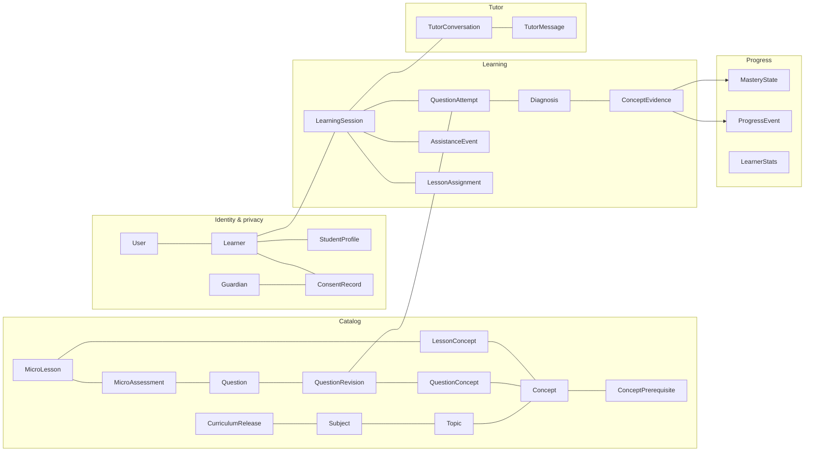

# 03 · Canonical learning domain

Vocabulary: the UI says **inti** or **core**. The domain says **Concept**. A *question loop* is the `/coba` pattern (question → diagnosis → micro-lesson → quick check → retry → completion).

## 1. Context map

## 2. Entities and their representation

Rule of thumb: an entity gets its **own table** when one of these holds:
- other rows reference it by key;
- it has its own lifecycle;
- it is queried or filtered on its own;
- it needs ownership or deletion handling of its own.

It is a **value object in JSONB** when it is always read and written as a unit with its parent, is immutable with that parent, and nothing references its parts.

| Entity (brief) | Representation | Why | Owner module |
|---|---|---|---|
| User | Table `app_user` + `auth_identity` | A login account (student or guardian). Identities (Google `sub`, verified email) change independently and must be unique per issuer. | identity |
| StudentProfile | Table `learner` (principal) + table `student_profile` (1:1) | `learner` is the stable owner of all learning data, so login identities can be linked or unlinked without rehoming evidence. Guardians are users but not learners. A future server-side guest would be a learner without a user. The profile (grade, age band, nickname, timezone, subjects) has its own consent-gated update rules. | privacy |
| Curriculum | Table `curriculum_release` | The unit of publication and versioning. A session pins a release. Stores an immutable JSON snapshot for audit. | catalog |
| Subject | Table `subject` | Referenced by topics and by profile preferences. Availability flag ("Segera"). | catalog |
| Topic | Table `topic` (units as JSONB) | Referenced by concepts and relations. **Units** (Bagian) are an ordered presentation grouping read as a whole, so they stay JSONB. | catalog |
| Concept | Table `concept` (objectives and misconceptions as JSONB) | Referenced by evidence, mastery, mappings and prerequisites. K03 fields are read as a whole by lessons and the AI context builder. Misconception codes are validated at publish time and when evidence is written. | catalog |
| ConceptPrerequisite | Table `concept_prerequisite` | A graph edge with a hard/soft kind. Needs FK integrity and DAG validation per release. | catalog |
| — (topic relation) | Table `topic_relation` | Cross-topic `REQUIRES` / `RELATED` links (Eksponen → Barisan). FK integrity between topics. | catalog |
| Question | Tables `question` (identity, family, owner, visibility) + `question_revision` (immutable content) | Attempts must reference the exact text and rubric the learner saw. Editing creates a new revision. `family_code` groups equivalent items, so a repeat is not counted as independent. | catalog / intake |
| QuestionConcept | Table `question_concept`, keyed by revision | Reviewed mapping (`PRIMARY` / `SUPPORTING`, `assessable`). Used for bank filters, evidence validation and K02 `QUESTION_APPLICATION` (derived: concepts from ≥2 topics on one revision). | catalog |
| — (solution paths, steps) | JSONB inside `question_revision.rubric` | K01 multi-strategy structure. Read only as a whole by evaluators and the AI context builder, and immutable with the revision. Publish-time validation guarantees every step's concepts are in `question_concept`. | catalog |
| LearningSession | Table `learning_session` (aggregate root) | Owns state, version, pinned content, checkpoint and outcome. Two kinds: `QUESTION_LOOP` and ``[{conceptId, action: LEARN|PRACTICE|RETRY, lessonId?, reason, keyFormula?, estimatedMinutes}]`. `keyFormula` comes from the lesson summary and feeds the legacy `next.formula` field.` ([05](05-learning-state-machine.md)). | learning |
| — (session items) | Table `session_item` | Fixed, server-chosen item order for ``[{conceptId, action: LEARN|PRACTICE|RETRY, lessonId?, reason, keyFormula?, estimatedMinutes}]`. `keyFormula` comes from the lesson summary and feeds the legacy `next.formula` field.` sessions, so a client cannot swap in easier items. | learning |
| — (lesson assignment) | Table `lesson_assignment` | Which lesson revision and quick checks the server assigned, the slide checkpoint, and skip/complete status. History when several lessons are opened. | learning |
| QuestionAttempt | Table `question_attempt` | Immutable submission. Kind, revision, ordinal, assistance snapshot, verdict. | learning |
| StudentResponse | **Value object**: `question_attempt.response` (JSONB) | Always read and written with its attempt and never referenced on its own. Typed by `responseType` (`TEXT`, `OPTION`, `NUMERIC`, `SELF_REPORT`) and versioned. Its raw text is the main expiry target ([04 §8](04-postgresql-erd.md#8-retention-and-deletion)). | learning |
| — (assistance / exposure) | Table `assistance_event` (append-only) | Blueprint A04: hints, lessons, tutor hints and solution exposure decide **eligibility** and outlive one tab or session. Queried by learner and question family. | learning |
| Diagnosis | Table `diagnosis_run` | Its own lifecycle (`QUEUED` → `COMPLETED`/`FAILED`), retries by generation, provenance, polling target (A01). | assessment |
| ConceptEvidence | Table `concept_evidence` (append-only, supersedable) | Queried per learner and concept for mastery. Auditable attribution and eligibility. | assessment |
| — (diagnosis report) | Table `diagnosis_report` | A learner's "Hasil keliru? Laporkan" dispute of one run. It has its own lifecycle (`OPEN` → `UPHELD` / `REJECTED`) and feeds a staff review queue. It is the human-review safeguard for diagnostic profiling ([06 §9](06-diagnosis-evidence-mastery.md#9-auditability-and-disputes), [08](08-auth-security-privacy.md)). | assessment |
| MasteryState | Table `mastery_state` (projection) | Read on every Home, Map and Progress view. Rebuildable from evidence and policy. **AI never writes it.** | progress |
| MicroLesson | Tables `micro_lesson` (identity) + `micro_lesson_revision` (immutable content, blocks as JSONB) | Referenced by assignments, which pin the revision the learner saw. Blocks (text, math, figure refs, worked steps) are read as a unit. No executable HTML. Editing creates a new revision, as for questions (D1). | catalog |
| — (lesson ↔ concept) | Table `lesson_concept` | One lesson can teach several concepts (`tri-d`, `tri-e` → one lesson) **without** making those concepts equal. | catalog |
| MicroAssessment | Table `micro_assessment` | Links a lesson revision to its quick-check questions (`ordinal`, `required`). The check is itself a question revision with a deterministic rubric. | catalog |
| — (aliases) | Table `catalog_alias` | Every legacy identifier per release and namespace, pointing at exactly one entity. Its primary key makes an ambiguous alias unpublishable (D2). | catalog |
| TutorConversation | Table `tutor_conversation` | Scoped to session and concept, with a context version and a hint counter. Short retention. | tutor |
| TutorMessage | Table `tutor_message` | Ordered, asynchronous status per assistant message. Moderation result. | tutor |
| ProgressEvent | Table `progress_event` (append-only) | Server-made facts (attempt graded, lesson completed, tier changed, XP awarded). Drives the activity feed, streak and XP. **Not** product analytics. | progress |
| — (stats) | Table `learner_stats` (projection) | XP total, streak and freezes, read on every page. Rebuildable from events. | progress |
| — (guardian, consent) | Tables `guardian`, `consent_record` | Legal accountability (UU PDP Pasal 25, PP 17/2025 Pasal 9). Revocation blocks processing. | privacy |
| — (intake) | Tables `question_intake`, `private_asset` | Upload/OCR lifecycle and private object handling (slice 6). | intake |

Deliberately **not** modelled:
- a generic EAV engine;
- an event-sourced store;
- a separate "reasoning" resource (A01: one run);
- a vector store;
- a lesson-run table separate from `lesson_assignment`;
- leaderboards.

## 3. Identifiers

| Kind | Format | Rule |
|---|---|---|
| Server entity IDs | **UUIDv7** (time-ordered) | Generated by the server. Opaque to clients. Never derived from browser data (blueprint D06). |
| Stable content codes | `MAT.TRI.RATIO_DEF`-style `code` | Reviewed, unique per entity type, stable across releases. Human-readable. |
| Legacy aliases | `legacy_map_id` (`tri-d`), `route_slug` (`perbandingan-trig`), `legacy_item_id` (`c4`, `gab-sin30-pangkat`) | Loaded from a reviewed alias manifest into `catalog_alias` (namespaces `SUBJECT`, `TOPIC`, `MAP`, `TYPED_MAP`, `ROUTE`, `TYPED_LESSON`, `ITEM`). Unique per release. Unknown → `404`, ambiguous → publish fails. |
| Question family | `family_code` | Equivalent items share it. A repeat within a family counts once toward mastery. The anchor question and its retries share one family. |
| Content version | `question_revision.id` + `revision` integer, `curriculum_release.version` | Every attempt stores its `question_revision_id`. Every session stores its `release_id` (A03 `contentVersion`). |
| Client operation keys | `Idempotency-Key` header (UUID recommended) | Scoped to learner + operation. Never an authorization. Also serves as the blueprint's `clientAttemptId` on attempt submission. |
| External identities | `(provider, subject)` in `auth_identity` | Never used as a primary or foreign key elsewhere. |

The `tri-d` → `Definisi sin, cos, tan` → lesson `perbandingan-trig` chain illustrates the rule: three namespaces, three explicit mappings, no inference from shared route slugs.

## 4. Ownership boundaries

- **Learner-owned (personal data):** `learner`, `student_profile`, `learning_session` and everything under it, `assistance_event`, `diagnosis_run`, `concept_evidence`, `diagnosis_report`, `mastery_state`, `progress_event`, `learner_stats`, `tutor_*`, `question_intake`, `private_asset`, private question revisions (`question.owner_learner_id`), the learner's `idempotency_record` rows and `ai_invocation` (pseudonymous link).
- **Guardian-owned:** `guardian` contact data and their consent decisions. A consent record is visible to both parties.
- **Organization-owned:** catalog (public content and private rubrics), feature flags, prompts and schemas.
- **System:** `job`, `budget_counter`, `audit_event` (subject reference only).

Every learner-scoped query filters on the `learner_id` derived from the authenticated session. A resource ID belonging to someone else returns `404`, the same as one that does not exist ([08](08-auth-security-privacy.md)).

## 5. Timestamps

All timestamps are `timestamptz`, set by the database clock (UTC).

| Column | Meaning |
|---|---|
| `created_at` | Row inserted |
| `updated_at` | Last mutation (mutable rows only) |
| `submitted_at` | Attempt accepted by the server. Orders attempts and exposures. |
| `occurred_at` | When a server fact happened (events) |
| `completed_at` | Terminal success of a process or session |
| `expires_at` | Deadline for automatic expiry (sessions, tokens, intakes) |
| `client_reported_at` | Informational only, from the client. **Never** used for ordering, eligibility or streaks. |

Streaks and daily missions use the learner's **profile timezone** (default `Asia/Jakarta`) to bucket server timestamps into local dates.

## 6. Lifecycles

| Entity | States |
|---|---|
| `learner.status` | `PENDING_CONSENT` → `ACTIVE` ⇄ `SUSPENDED` → `DELETION_PENDING` → *(row erased)* |
| `consent_record.status` | `PENDING` → `GRANTED` \| `DECLINED` \| `EXPIRED`. `GRANTED` → `REVOKED` |
| `curriculum_release.status`, `question_revision.status` | `DRAFT` → `PUBLISHED` → `RETIRED` (published content is immutable) |
| `learning_session.state` | See [05](05-learning-state-machine.md). Terminal: `COMPLETED`, `ABANDONED`, `EXPIRED` |
| `question_attempt.verdict` | `PENDING` → `CORRECT` \| `INCORRECT` \| `UNREADABLE` \| `NOT_GRADED`. Regrade only through a new diagnosis generation (audited). |
| `diagnosis_run.status` | `QUEUED` → `RUNNING` → `COMPLETED` \| `FAILED` \| `CANCELLED` (terminal rows immutable) |
| `concept_evidence` | Append-only. A correction appends a superseding row. |
| `diagnosis_report.status` | `OPEN` → `UPHELD` \| `REJECTED`. An upheld report leads to an `EDUCATOR` correction row ([06 §9](06-diagnosis-evidence-mastery.md#9-auditability-and-disputes)). |
| `tutor_message.status` | `PENDING` → `COMPLETED` \| `FAILED` \| `BLOCKED` |
| `question_intake.status` | `RECEIVED` → `READING` → `READ` → `CONFIRMED` \| `DISCARDED` \| `FAILED` \| `EXPIRED` |
| `job.status` | `QUEUED` → `RUNNING` → `DONE` \| `FAILED` \| `CANCELLED` |
| `deletion_request.status` | `QUEUED` → `RUNNING` → `COMPLETED` \| `FAILED` (retried) |

## 7. Value objects (JSONB schemas, versioned)

| Value object | Stored in | Shape (v1) |
|---|---|---|
| `StudentResponse` | `question_attempt.response` | `{schemaVersion: 1, responseType: TEXT\|OPTION\|NUMERIC\|SELF_REPORT, text?, optionId?, numeric?, selfReport?: KNOW\|DONT_KNOW, inputMode: TYPED\|OCR_CONFIRMED\|DEVICE_IMPORT}`. Text ≤ 2,000 chars. `SELF_REPORT` ("Saya tahu caranya" / "belum tahu") is never graded ([05 §4.4](05-learning-state-machine.md#44-self-reported-responses)). |
| `QuestionBody` | `question_revision.body` | `{prompt, figureRef?, options?[{id, label}], hints[{step, conceptCode, lead, note}], answerFormat}`. **No keys.** |
| `Rubric` | `question_revision.rubric` (private) | `{evaluator: "numeric-v1"\|"option-v1"\|"tower-v1"\|"ai-assisted-v1", answer: {...}, acceptedForms[], solutionPaths[{code, label, steps[{code, description, concepts[{code, role}]}]}], misconceptionMap[{pattern, conceptCode, misconceptionCode, explanation}], finalAnswerEvidence[conceptCode], workedSolution {steps[{title, body}], after[]}}`. `finalAnswerEvidence` lists the concepts every valid path to the answer requires ([06 §10](06-diagnosis-evidence-mastery.md#10-worked-example-the-tower-question)). `acceptedForms` also feeds the tutor's answer filter. |
| `LessonBlocks` | `micro_lesson_revision.blocks` | Ordered `[{type: heading\|text\|math\|figure\|worked_example\|tip, slide, ...}]`; math is `{name, expression, highlight?}` or `latex`. Sanitized. No HTML. |
| `EvidenceRefs` | `concept_evidence.refs` | `[{kind: SPAN, start, end, quote} \| {kind: OPTION, optionId} \| {kind: STEP, pathCode, stepCode}]` |
| `Recommendations` | `diagnosis_run.recommendations` | `[{conceptId, action: LEARN\|PRACTICE\|RETRY, lessonId?, reason, keyFormula?, estimatedMinutes}]`. `keyFormula` comes from the lesson summary and feeds the legacy `next.formula` field. |
| `Continuation` | `auth_transaction.continuation`, `learning_session.checkpoint` | `{sessionId?, route: enum of allowed app routes, lessonStep?}`. Never an arbitrary URL. |
| `Provenance` | `diagnosis_run.provenance` | `{engine, rubricVersion, policyVersion, promptVersion?, model?, inputHash, invocationIds[]}`. No raw prompts and no chain of thought. |

Every JSONB column has a size cap and a schema version. Writers validate against the schema; unknown versions are rejected ([04 §6](04-postgresql-erd.md#6-jsonb-policy)).

## 8. Domain invariants

Each invariant is tested ([11](11-test-matrix.md)).

| ID | Invariant |
|---|---|
| INV-01 | Every learner-owned row belongs to exactly one learner. A request can only see rows of the authenticated learner; anything else returns `404`. |
| INV-02 | Learning data is persisted only for a learner whose status is `ACTIVE` and who holds a `GRANTED` `LEARNING_DATA` consent. The consent bootstrap keeps only the minimum needed to obtain consent, and only until it expires. |
| INV-03 | Child free text and images (class C3) reach an AI provider only under a `GRANTED` `AI_PROCESSING` consent, minimised and redacted. |
| INV-04 | Published catalog content is immutable. Sessions pin a release, and attempts pin a question revision. |
| INV-05 | Rubrics and answer keys never appear in learner-facing responses. The only exception is public-practice items evaluated statelessly for guests, which never become evidence. |
| INV-06 | A session changes state only through a legal command or job completion ([05](05-learning-state-machine.md)). Each change increments `state_version` by exactly 1. |
| INV-07 | An attempt is immutable once stored: response, kind, revision and assistance snapshot. |
| INV-08 | An attempt has at most one non-terminal diagnosis run. Terminal runs are immutable. |
| INV-09 | Evidence may cite only spans, options or steps that exist in the attempt's response or rubric, and only concepts mapped on that question revision. |
| INV-10 | Evidence whose only source is AI is not mastery-eligible under `mastery-v1`. |
| INV-11 | Mastery and stats are deterministic functions of eligible evidence, events and policy version. Replaying them in any order gives the same result. |
| INV-12 | Exposure (hint, tutor, solution) never changes a verdict. It only changes eligibility (A04). |
| INV-13 | The anchor question and its retries never count as independent transfer evidence. |
| INV-14 | One `(learner, operation, Idempotency-Key)` maps to one outcome. Reusing the key with a different payload is rejected. |
| INV-15 | XP and streaks come only from server rules, once per event key. No client can post XP. |
| INV-16 | `UNREADABLE` and `NOT_ASSESSED` never count as incorrect and never consume a retry allowance. |
| INV-17 | Hard prerequisite edges form a DAG per release. Soft edges and question applications never lock content. |
| INV-18 | The tutor never states a final answer before the solution-review gate. Passing the gate records a `FULL_SOLUTION_SHOWN` exposure. |
| INV-19 | Erasure removes every learner-owned row and object. Only a non-identifying erasure receipt remains. |
| INV-20 | A consent decision is attributable: who decided, when, and the hash of the policy text shown. Revocation blocks new processing immediately. |
| INV-21 | History imported from a device is never mastery-eligible. |
| INV-22 | Server time orders everything. Client timestamps are informational. |
