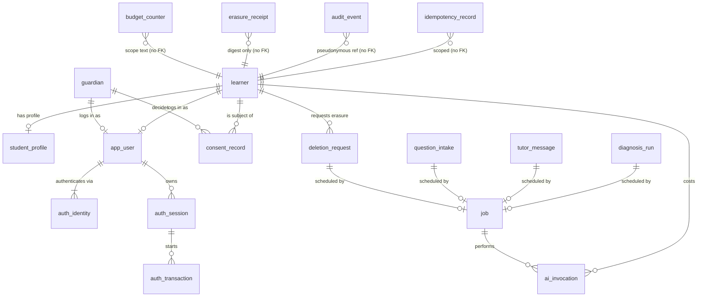
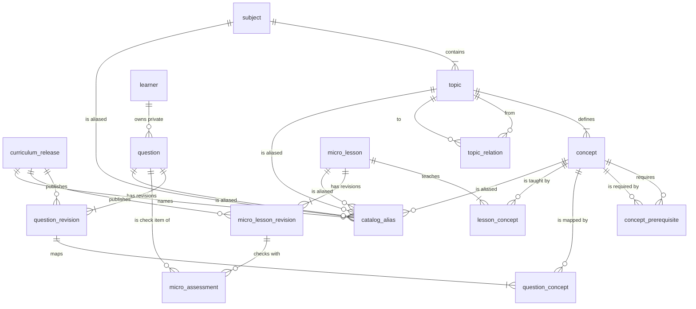
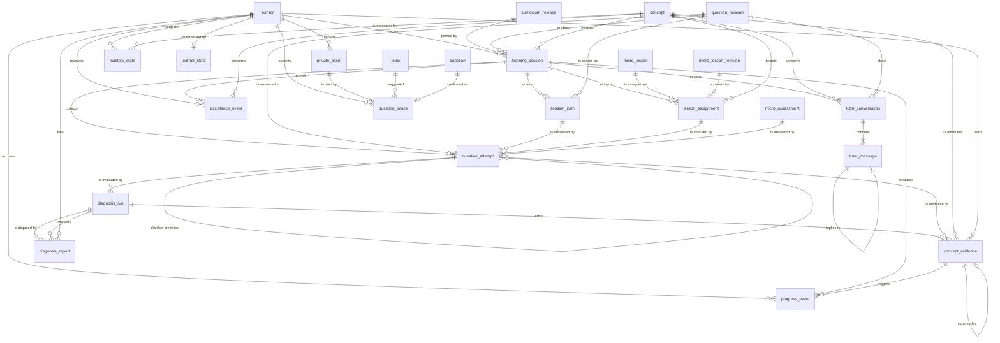

# 04 · PostgreSQL data model

**Specification only. No migration has been executed.** The DDL below is normative for the first implementation. A real migration test against PostgreSQL 16+ is an acceptance gate ([11](11-test-matrix.md), [12](12-implementation-roadmap.md)).

## Conventions

- `id uuid` primary keys are **UUIDv7 generated by the application**. The `uuidv7()` default may replace this on PostgreSQL 18+.
- Enumerations are `text` + `CHECK`, which is easier to evolve than `CREATE TYPE … AS ENUM`.
- All timestamps are `timestamptz` and come from the database clock. `created_at` defaults to `now()`. Mutable tables also have `updated_at` (maintained by the application) and, for aggregates, `version bigint`.
- Foreign keys default to `ON DELETE RESTRICT`. Learner data is removed by an explicit, ordered erasure procedure (§8), never by silent cascades.
- **Composite foreign keys** enforce "same session" and "same learner" membership wherever a child row repeats an owner column.
- Every FK column that does not lead another index gets its own B-tree index (§5).

## 1. Entity–relationship diagrams

Three diagrams cover the 44 tables. Every FK in §2–§4 appears as a relationship.

### 1.1 Identity, privacy and platform



### 1.2 Catalog



### 1.3 Learning, assessment, progress, tutor, intake



## 2. Identity, privacy and platform tables

```sql
CREATE TABLE learner (
  id                    uuid PRIMARY KEY,
  status                text NOT NULL CHECK (status IN ('PENDING_CONSENT','ACTIVE','SUSPENDED','DELETION_PENDING')),
  age_band              text NOT NULL CHECK (age_band IN ('UNDER_13','AGE_13_15','AGE_16_17','ADULT','UNKNOWN')),
  age_band_source       text NOT NULL CHECK (age_band_source IN ('SELF_DECLARED','GUARDIAN_CONFIRMED','VERIFIED')),
  consent_deadline_at   timestamptz,               -- PENDING_CONSENT bootstrap data is erased after this
  created_at            timestamptz NOT NULL DEFAULT now(),
  updated_at            timestamptz NOT NULL DEFAULT now(),
  version               bigint NOT NULL DEFAULT 1 CHECK (version >= 1),
  CHECK (status <> 'PENDING_CONSENT' OR consent_deadline_at IS NOT NULL)
);

CREATE TABLE guardian (
  id                 uuid PRIMARY KEY,
  email_hash         bytea NOT NULL UNIQUE,         -- HMAC(normalized email); lookup only
  email_ciphertext   bytea NOT NULL,                -- envelope-encrypted; consent/revocation notices only
  verified_at        timestamptz,
  created_at         timestamptz NOT NULL DEFAULT now(),
  updated_at         timestamptz NOT NULL DEFAULT now()
);

CREATE TABLE app_user (
  id           uuid PRIMARY KEY,
  role         text NOT NULL CHECK (role IN ('STUDENT','GUARDIAN')),
  learner_id   uuid UNIQUE REFERENCES learner(id),
  guardian_id  uuid UNIQUE REFERENCES guardian(id),
  status       text NOT NULL CHECK (status IN ('ACTIVE','DISABLED','DELETION_PENDING')),
  created_at   timestamptz NOT NULL DEFAULT now(),
  updated_at   timestamptz NOT NULL DEFAULT now(),
  CHECK ((role = 'STUDENT'  AND learner_id IS NOT NULL AND guardian_id IS NULL)
      OR (role = 'GUARDIAN' AND guardian_id IS NOT NULL AND learner_id IS NULL))
);

CREATE TABLE auth_identity (
  id                uuid PRIMARY KEY,
  user_id           uuid NOT NULL REFERENCES app_user(id),
  provider          text NOT NULL CHECK (provider IN ('GOOGLE','EMAIL')),
  subject           text NOT NULL,                  -- Google "sub"; for EMAIL the HMAC of the verified address
  email_verified    boolean NOT NULL,
  email_ciphertext  bytea,                          -- only if needed for transactional mail
  last_login_at     timestamptz,
  created_at        timestamptz NOT NULL DEFAULT now(),
  UNIQUE (provider, subject)
);

CREATE TABLE auth_session (
  id                    uuid PRIMARY KEY,
  token_hash            bytea NOT NULL UNIQUE,      -- SHA-256 of the 256-bit opaque cookie value
  csrf_secret_hash      bytea NOT NULL,
  user_id               uuid REFERENCES app_user(id),   -- NULL = anonymous pre-auth session (OAuth binding only)
  created_at            timestamptz NOT NULL DEFAULT now(),
  last_seen_at          timestamptz NOT NULL DEFAULT now(),
  idle_expires_at       timestamptz NOT NULL,
  absolute_expires_at   timestamptz NOT NULL,
  revoked_at            timestamptz
);

CREATE TABLE auth_transaction (
  id                         uuid PRIMARY KEY,
  session_id                 uuid NOT NULL REFERENCES auth_session(id),
  provider                   text NOT NULL CHECK (provider IN ('GOOGLE','EMAIL')),
  state_hash                 bytea NOT NULL UNIQUE,
  nonce_hash                 bytea,
  pkce_verifier_ciphertext   bytea,
  continuation               jsonb NOT NULL,       -- Continuation VO: allow-listed route + optional sessionId/lessonStep
  expires_at                 timestamptz NOT NULL,
  consumed_at                timestamptz,
  created_at                 timestamptz NOT NULL DEFAULT now()
);

CREATE TABLE student_profile (
  learner_id               uuid PRIMARY KEY REFERENCES learner(id),
  display_name             varchar(40),          -- optional nickname; never a legal name requirement
  grade                    smallint CHECK (grade BETWEEN 7 AND 12),
  timezone                 text NOT NULL DEFAULT 'Asia/Jakarta' CHECK (timezone IN ('Asia/Jakarta','Asia/Makassar','Asia/Jayapura')),
  preferred_subject_codes  text[] NOT NULL DEFAULT '{}',
  created_at               timestamptz NOT NULL DEFAULT now(),
  updated_at               timestamptz NOT NULL DEFAULT now()
);

CREATE TABLE consent_record (
  id                   uuid PRIMARY KEY,
  learner_id           uuid NOT NULL REFERENCES learner(id),
  guardian_id          uuid NOT NULL REFERENCES guardian(id),   -- the guardian who decides or is notified
  purpose              text NOT NULL CHECK (purpose IN ('LEARNING_DATA','AI_PROCESSING','IMAGE_UPLOAD','PRODUCT_ANALYTICS')),
  status               text NOT NULL CHECK (status IN ('PENDING','GRANTED','DECLINED','EXPIRED','REVOKED')),
  method               text NOT NULL CHECK (method IN ('GUARDIAN_EMAIL','GUARDIAN_SIGNIN','SELF_WITH_GUARDIAN_NOTICE')),
  policy_version       text NOT NULL,
  policy_text_sha256   bytea NOT NULL,           -- exact text shown to the decider
  request_token_hash   bytea UNIQUE,             -- one-time link token, hashed
  decided_by           text CHECK (decided_by IN ('GUARDIAN','LEARNER','SYSTEM')),
  requested_at         timestamptz NOT NULL DEFAULT now(),
  decided_at           timestamptz,
  revoked_at           timestamptz,
  expires_at           timestamptz NOT NULL,
  created_at           timestamptz NOT NULL DEFAULT now(),
  updated_at           timestamptz NOT NULL DEFAULT now(),
  CHECK (status <> 'GRANTED' OR decided_at IS NOT NULL)
);
CREATE UNIQUE INDEX consent_one_live_per_purpose ON consent_record (learner_id, purpose) WHERE status IN ('PENDING','GRANTED');

CREATE TABLE deletion_request (
  id             uuid PRIMARY KEY,
  learner_id     uuid NOT NULL REFERENCES learner(id),
  requested_by   text NOT NULL CHECK (requested_by IN ('LEARNER','GUARDIAN','SYSTEM')),
  reason         text NOT NULL CHECK (reason IN ('USER_REQUEST','CONSENT_DECLINED','CONSENT_REVOKED','CONSENT_EXPIRED','INACTIVITY','OTHER')),
  status         text NOT NULL CHECK (status IN ('QUEUED','RUNNING','COMPLETED','FAILED')),
  attempts       smallint NOT NULL DEFAULT 0,
  last_error     text,
  requested_at   timestamptz NOT NULL DEFAULT now(),
  started_at     timestamptz,
  completed_at   timestamptz
);
CREATE UNIQUE INDEX deletion_one_active ON deletion_request (learner_id) WHERE status IN ('QUEUED','RUNNING');

CREATE TABLE erasure_receipt (                      -- restricted schema; no FK by design
  receipt_id          uuid PRIMARY KEY,
  subject_digest      bytea NOT NULL UNIQUE,         -- HMAC(learner_id) under a restricted key; replayed after backup restore
  completed_at        timestamptz NOT NULL,
  backup_purge_after  timestamptz NOT NULL
);

CREATE TABLE audit_event (
  id               uuid PRIMARY KEY,
  occurred_at      timestamptz NOT NULL DEFAULT now(),
  actor_type       text NOT NULL CHECK (actor_type IN ('LEARNER','GUARDIAN','STAFF','SYSTEM')),
  actor_ref        bytea,                             -- pseudonymous HMAC
  subject_ref      bytea,                             -- pseudonymous HMAC of learner_id; no FK
  action           text NOT NULL,                     -- e.g. CONSENT_GRANTED, DELETION_COMPLETED, STAFF_VIEWED_SESSION
  detail           jsonb NOT NULL DEFAULT '{}'        -- ≤ 2 KB, no free text from learners
);

CREATE TABLE idempotency_record (
  scope_kind       text NOT NULL CHECK (scope_kind IN ('LEARNER','GUARDIAN','AUTH_SESSION')),
  scope_id         uuid NOT NULL,                     -- no FK: erasure deletes by scope_id
  operation        text NOT NULL,                     -- "METHOD route-template" + resource id
  key              varchar(128) NOT NULL,
  request_sha256   bytea NOT NULL,
  status           text NOT NULL CHECK (status IN ('IN_PROGRESS','COMPLETED')),
  response_status  smallint,
  response_body    jsonb,                             -- business payload only; never secrets
  created_at       timestamptz NOT NULL DEFAULT now(),
  expires_at       timestamptz NOT NULL,
  PRIMARY KEY (scope_kind, scope_id, operation, key)
);

CREATE TABLE job (
  id                   uuid PRIMARY KEY,
  queue                text NOT NULL CHECK (queue IN ('diagnosis','tutor','intake','deletion','projection')),
  diagnosis_run_id     uuid UNIQUE REFERENCES diagnosis_run(id),
  tutor_message_id     uuid UNIQUE REFERENCES tutor_message(id),
  question_intake_id   uuid UNIQUE REFERENCES question_intake(id),
  deletion_request_id  uuid UNIQUE REFERENCES deletion_request(id),
  status               text NOT NULL CHECK (status IN ('QUEUED','RUNNING','DONE','FAILED','CANCELLED')),
  priority             smallint NOT NULL DEFAULT 0,
  available_at         timestamptz NOT NULL DEFAULT now(),
  lease_token          uuid,
  lease_until          timestamptz,
  attempts             smallint NOT NULL DEFAULT 0 CHECK (attempts >= 0),
  max_attempts         smallint NOT NULL DEFAULT 3 CHECK (max_attempts BETWEEN 1 AND 5),
  deadline_at          timestamptz NOT NULL,
  last_error_code      text,
  created_at           timestamptz NOT NULL DEFAULT now(),
  updated_at           timestamptz NOT NULL DEFAULT now(),
  CHECK (num_nonnulls(diagnosis_run_id, tutor_message_id, question_intake_id, deletion_request_id) = 1),
  CHECK ((status = 'RUNNING') = (lease_token IS NOT NULL AND lease_until IS NOT NULL))
);

CREATE TABLE ai_invocation (
  id                    uuid PRIMARY KEY,
  learner_id            uuid REFERENCES learner(id),   -- set NULL during erasure; cost ledger survives
  job_id                uuid REFERENCES job(id),
  purpose               text NOT NULL CHECK (purpose IN ('DIAGNOSIS','TUTOR','OCR','INTAKE_MAPPING','EVALUATION')),
  provider              text NOT NULL,
  model                 text NOT NULL,
  prompt_version        text NOT NULL,
  schema_version        text,
  status                text NOT NULL CHECK (status IN ('SUCCEEDED','REJECTED_OUTPUT','REFUSED','TRUNCATED','PROVIDER_ERROR','TIMEOUT','BUDGET_DENIED')),
  input_tokens          int,
  output_tokens         int,
  cache_read_tokens     int,
  cache_write_tokens    int,
  cost_microusd         bigint NOT NULL DEFAULT 0 CHECK (cost_microusd >= 0),
  latency_ms            int,
  provider_request_id   text,
  created_at            timestamptz NOT NULL DEFAULT now()
);

CREATE TABLE budget_counter (
  scope              text NOT NULL,                  -- 'global' or 'learner:<uuid>'; erasure deletes learner scopes
  purpose            text NOT NULL CHECK (purpose IN ('DIAGNOSIS','TUTOR','OCR','INTAKE_MAPPING')),
  window_kind        text NOT NULL CHECK (window_kind IN ('HOUR','DAY')),
  window_start       timestamptz NOT NULL,
  calls              int NOT NULL DEFAULT 0 CHECK (calls >= 0),
  reserved_microusd  bigint NOT NULL DEFAULT 0 CHECK (reserved_microusd >= 0),
  spent_microusd     bigint NOT NULL DEFAULT 0 CHECK (spent_microusd >= 0),
  version            bigint NOT NULL DEFAULT 1,
  PRIMARY KEY (scope, purpose, window_kind, window_start)
);
```

## 3. Catalog tables

```sql
CREATE TABLE curriculum_release (
  id                uuid PRIMARY KEY,
  version           int NOT NULL UNIQUE CHECK (version > 0),
  status            text NOT NULL CHECK (status IN ('DRAFT','PUBLISHED','RETIRED')),
  is_current        boolean NOT NULL DEFAULT false,
  snapshot          jsonb,                           -- immutable full catalog snapshot written at publish
  snapshot_sha256   bytea,
  published_at      timestamptz,
  created_at        timestamptz NOT NULL DEFAULT now(),
  CHECK (status <> 'PUBLISHED' OR (snapshot IS NOT NULL AND published_at IS NOT NULL)),
  CHECK (NOT is_current OR status = 'PUBLISHED')
);
CREATE UNIQUE INDEX release_one_current ON curriculum_release ((is_current)) WHERE is_current;

CREATE TABLE subject (
  id                     uuid PRIMARY KEY,
  code                   text NOT NULL UNIQUE,        -- 'MAT','FIS','KIM','BIO','ING','PRO'
  title                  text NOT NULL,
  availability           text NOT NULL CHECK (availability IN ('AVAILABLE','COMING_SOON')),
  created_at             timestamptz NOT NULL DEFAULT now(),
  updated_at             timestamptz NOT NULL DEFAULT now()
);

CREATE TABLE topic (
  id            uuid PRIMARY KEY,
  subject_id    uuid NOT NULL REFERENCES subject(id),
  code          text NOT NULL UNIQUE,                 -- 'MAT.TRI'
  legacy_id     text UNIQUE,                          -- 'trigonometri'
  title         text NOT NULL,
  subtitle      text,
  phase         text NOT NULL CHECK (phase IN ('D','E','F','F+')),
  availability  text NOT NULL CHECK (availability IN ('MAPPED','PLANNED')),
  units         jsonb NOT NULL DEFAULT '[]',          -- [{code,title,goal,ordinal}] presentation grouping
  bekal         text[] NOT NULL DEFAULT '{}',
  created_at    timestamptz NOT NULL DEFAULT now(),
  updated_at    timestamptz NOT NULL DEFAULT now()
);

CREATE TABLE topic_relation (
  from_topic_id  uuid NOT NULL REFERENCES topic(id),
  to_topic_id    uuid NOT NULL REFERENCES topic(id),
  kind           text NOT NULL CHECK (kind IN ('REQUIRES','RELATED')),
  label          text NOT NULL,
  source         text NOT NULL CHECK (source IN ('CURRICULUM','MATHEMATICAL')),
  PRIMARY KEY (from_topic_id, to_topic_id),
  CHECK (from_topic_id <> to_topic_id)
);

CREATE TABLE concept (
  id                  uuid PRIMARY KEY,
  topic_id            uuid NOT NULL REFERENCES topic(id),
  code                text NOT NULL UNIQUE,           -- 'MAT.TRI.RATIO_DEF'
  legacy_map_id       text UNIQUE,                    -- 'tri-d'
  title               text NOT NULL,
  subtitle            text,
  definition          text,
  objectives          jsonb NOT NULL DEFAULT '[]',    -- K03: measurable objectives
  misconceptions      jsonb NOT NULL DEFAULT '[]',    -- K03: [{code, description, example, indicators[]}]
  unit_code           text,
  ordinal             smallint NOT NULL,
  estimated_minutes   smallint NOT NULL CHECK (estimated_minutes BETWEEN 1 AND 60),
  is_hidden           boolean NOT NULL DEFAULT false, -- e.g. topic prerequisite placeholder ("Prasyarat")
  is_capstone         boolean NOT NULL DEFAULT false,
  availability        text NOT NULL CHECK (availability IN ('READY','PLANNED')),
  created_at          timestamptz NOT NULL DEFAULT now(),
  updated_at          timestamptz NOT NULL DEFAULT now()
);

CREATE TABLE concept_prerequisite (
  concept_id       uuid NOT NULL REFERENCES concept(id),
  prerequisite_id  uuid NOT NULL REFERENCES concept(id),
  kind             text NOT NULL CHECK (kind IN ('HARD','SOFT')),
  PRIMARY KEY (concept_id, prerequisite_id),
  CHECK (concept_id <> prerequisite_id)
);

CREATE TABLE question (
  id                uuid PRIMARY KEY,
  code              text NOT NULL UNIQUE,             -- 'MAT.TRI.Q.TOWER_DEPRESSION_01'
  legacy_item_id    text UNIQUE,                      -- 'soal-menara', 'c4', 'gab-sin30-pangkat'
  family_code       text NOT NULL,
  visibility        text NOT NULL CHECK (visibility IN ('PUBLIC_PRACTICE','CATALOG','PRIVATE')),
  owner_learner_id  uuid REFERENCES learner(id),
  origin            text NOT NULL CHECK (origin IN ('AUTHORED','INTAKE')),
  created_at        timestamptz NOT NULL DEFAULT now(),
  updated_at        timestamptz NOT NULL DEFAULT now(),
  CHECK ((visibility = 'PRIVATE') = (owner_learner_id IS NOT NULL)),
  CHECK ((origin = 'INTAKE') = (visibility = 'PRIVATE'))
);

CREATE TABLE question_revision (
  id                  uuid PRIMARY KEY,
  question_id         uuid NOT NULL REFERENCES question(id),
  revision            int NOT NULL CHECK (revision > 0),
  release_id          uuid REFERENCES curriculum_release(id),  -- NULL only for private intake questions
  status              text NOT NULL CHECK (status IN ('DRAFT','PUBLISHED','RETIRED')),
  item_type           text NOT NULL CHECK (item_type IN ('FREE_RESPONSE','MULTIPLE_CHOICE','NUMERIC')),
  body                jsonb NOT NULL,                  -- QuestionBody VO, never contains keys
  rubric              jsonb NOT NULL,                  -- Rubric VO, private
  review_status       text NOT NULL CHECK (review_status IN ('REVIEWED','UNREVIEWED')),
  context_tag         text NOT NULL,                   -- K05 variation: 'MENARA','TANGGA','BAYANGAN','BARE_VALUE',...
  difficulty          smallint NOT NULL CHECK (difficulty BETWEEN 1 AND 3),
  estimated_minutes   smallint NOT NULL CHECK (estimated_minutes BETWEEN 1 AND 30),
  provenance          jsonb NOT NULL DEFAULT '{}',     -- authoring/source facts; no unverified exam claims
  published_at        timestamptz,
  created_at          timestamptz NOT NULL DEFAULT now(),
  UNIQUE (question_id, revision),
  CHECK (status <> 'PUBLISHED' OR published_at IS NOT NULL)
);
CREATE UNIQUE INDEX question_one_published_revision ON question_revision (question_id) WHERE status = 'PUBLISHED';

CREATE TABLE question_concept (
  question_revision_id  uuid NOT NULL REFERENCES question_revision(id),
  concept_id            uuid NOT NULL REFERENCES concept(id),
  role                  text NOT NULL CHECK (role IN ('PRIMARY','SUPPORTING')),
  assessable            boolean NOT NULL,
  PRIMARY KEY (question_revision_id, concept_id)
);

CREATE TABLE micro_lesson (                         -- identity only; content lives in revisions (D1)
  id                  uuid PRIMARY KEY,
  code                text NOT NULL UNIQUE,
  route_slug          text UNIQUE,                     -- 'perbandingan-trig' (primary ROUTE alias, from catalog_alias)
  created_at          timestamptz NOT NULL DEFAULT now(),
  updated_at          timestamptz NOT NULL DEFAULT now()
);

CREATE TABLE micro_lesson_revision (                -- immutable once published, like question_revision (INV-04)
  id                  uuid PRIMARY KEY,
  lesson_id           uuid NOT NULL REFERENCES micro_lesson(id),
  revision            int NOT NULL CHECK (revision > 0),   -- exposed as Lesson.contentVersion
  release_id          uuid NOT NULL REFERENCES curriculum_release(id),
  status              text NOT NULL CHECK (status IN ('DRAFT','PUBLISHED','RETIRED')),
  title               text NOT NULL,
  estimated_minutes   smallint NOT NULL CHECK (estimated_minutes BETWEEN 1 AND 20),
  blocks              jsonb NOT NULL,                  -- LessonBlocks VO
  published_at        timestamptz,
  created_at          timestamptz NOT NULL DEFAULT now(),
  UNIQUE (lesson_id, revision),
  CHECK (status <> 'PUBLISHED' OR published_at IS NOT NULL)
);
CREATE UNIQUE INDEX lesson_one_published_revision ON micro_lesson_revision (lesson_id) WHERE status = 'PUBLISHED';

CREATE TABLE lesson_concept (
  lesson_id   uuid NOT NULL REFERENCES micro_lesson(id),
  concept_id  uuid NOT NULL REFERENCES concept(id),
  PRIMARY KEY (lesson_id, concept_id)
);

CREATE TABLE micro_assessment (                     -- part of its lesson revision's immutable content
  id                  uuid PRIMARY KEY,
  lesson_revision_id  uuid NOT NULL REFERENCES micro_lesson_revision(id),
  question_id         uuid NOT NULL REFERENCES question(id),
  ordinal             smallint NOT NULL CHECK (ordinal >= 0),
  required            boolean NOT NULL DEFAULT true,
  slide_index         smallint NOT NULL CHECK (slide_index >= 0),   -- the slide after which the check appears
  UNIQUE (lesson_revision_id, ordinal),
  UNIQUE (lesson_revision_id, question_id)
);

CREATE TABLE catalog_alias (                        -- every legacy identifier, per release (D2)
  release_id   uuid NOT NULL REFERENCES curriculum_release(id),
  namespace    text NOT NULL CHECK (namespace IN ('SUBJECT','TOPIC','MAP','TYPED_MAP','ROUTE','TYPED_LESSON','ITEM')),
  alias        text NOT NULL CHECK (char_length(alias) BETWEEN 1 AND 120),
  subject_id   uuid REFERENCES subject(id),
  topic_id     uuid REFERENCES topic(id),
  concept_id   uuid REFERENCES concept(id),
  question_id  uuid REFERENCES question(id),
  lesson_id    uuid REFERENCES micro_lesson(id),
  PRIMARY KEY (release_id, namespace, alias),       -- an ambiguous alias cannot be published
  CHECK (num_nonnulls(subject_id, topic_id, concept_id, question_id, lesson_id) = 1)
);
```

Publication rule: a publish runs in one transaction that holds an advisory lock on the catalog. It validates the following, writes `curriculum_release.snapshot`, and flips `is_current`:

- every alias is unique;
- hard edges form a DAG;
- every `question_concept` concept exists;
- every rubric step concept is mapped as `question_concept` on the same revision;
- every misconception code exists on its concept;
- lesson checks are deterministic.

The input is the reviewed alias manifest (`catalog/manifest/`). A manifest with open review decisions is refused. Publishing an unchanged manifest (same canonical SHA-256) is a no-op; any other publish needs a higher release version. Changed content becomes a **new revision**: the old one moves `PUBLISHED` → `RETIRED`, and nothing is edited in place. Database triggers enforce this (INV-04). Published or retired `question_revision`, `micro_lesson_revision` and `curriculum_release` rows reject every update except that status change and the `is_current` flip. They also reject deletes, as do their `question_concept` and `micro_assessment` rows. Misconception codes on a concept are append-only, because evidence cites them. Concept, topic and subject rows are the current projection. The release snapshot and `catalog_alias` keep each release's view of them. Legacy alias columns (`topic.legacy_id`, `concept.legacy_map_id`, `question.legacy_item_id`, `micro_lesson.route_slug`) hold the first alias of their namespace from `catalog_alias`.

## 4. Learning, assessment, progress, tutor and intake tables

```sql
CREATE TABLE learning_session (
  id                           uuid PRIMARY KEY,
  learner_id                   uuid NOT NULL REFERENCES learner(id),
  kind                         text NOT NULL CHECK (kind IN ('QUESTION_LOOP','PRACTICE')),
  origin                       text NOT NULL CHECK (origin IN ('FUNNEL','BANK','CHALLENGE','CONCEPT_LESSON','COMBINED_SET','INTAKE','DEVICE_IMPORT')),
  release_id                   uuid NOT NULL REFERENCES curriculum_release(id),
  anchor_question_revision_id  uuid REFERENCES question_revision(id),
  focus_concept_id             uuid REFERENCES concept(id),
  state                        text NOT NULL CHECK (state IN ('QUESTION','DIAGNOSING','CLARIFICATION_NEEDED','DIAGNOSIS_READY','MICROLEARNING','QUICK_CHECK','RETRY','VERIFYING','EVALUATION_FAILED','PRACTICING','COMPLETED','ABANDONED','EXPIRED')),
  state_version                bigint NOT NULL DEFAULT 1 CHECK (state_version >= 1),
  resume_state                 text CHECK (resume_state IN ('DIAGNOSING','VERIFYING')),
  outcome                      text CHECK (outcome IN ('SOLVED_FIRST_TRY','SOLVED_AFTER_LEARNING','SOLUTION_REVIEWED','PRACTICE_FINISHED')),
  active_attempt_id            uuid,
  unsuccessful_retries         smallint NOT NULL DEFAULT 0 CHECK (unsuccessful_retries >= 0),
  checkpoint                   jsonb NOT NULL DEFAULT '{}',   -- Continuation VO for UI resume (validated)
  legacy_client_session_id     text,                          -- alias used by the /v1/learning/* facade
  started_at                   timestamptz NOT NULL DEFAULT now(),
  last_activity_at             timestamptz NOT NULL DEFAULT now(),
  completed_at                 timestamptz,
  expires_at                   timestamptz NOT NULL,
  created_at                   timestamptz NOT NULL DEFAULT now(),
  updated_at                   timestamptz NOT NULL DEFAULT now(),
  UNIQUE (id, learner_id),
  UNIQUE (learner_id, legacy_client_session_id),
  CHECK ((kind = 'QUESTION_LOOP') = (anchor_question_revision_id IS NOT NULL)),
  CHECK ((state = 'COMPLETED') = (outcome IS NOT NULL AND completed_at IS NOT NULL)),
  CHECK ((state = 'EVALUATION_FAILED') = (resume_state IS NOT NULL))
);
CREATE UNIQUE INDEX session_device_import_once ON learning_session (legacy_client_session_id)
  WHERE origin = 'DEVICE_IMPORT';                   -- a device session is imported at most once, by any account

CREATE TABLE session_item (
  id                    uuid PRIMARY KEY,
  session_id            uuid NOT NULL REFERENCES learning_session(id),
  ordinal               smallint NOT NULL CHECK (ordinal >= 1),
  question_revision_id  uuid NOT NULL REFERENCES question_revision(id),
  role                  text NOT NULL CHECK (role IN ('PRACTICE','TRANSFER')),
  status                text NOT NULL CHECK (status IN ('PENDING','ANSWERED','SKIPPED')),
  UNIQUE (session_id, ordinal),
  UNIQUE (id, session_id)
);

CREATE TABLE lesson_assignment (
  id                 uuid PRIMARY KEY,
  session_id         uuid NOT NULL REFERENCES learning_session(id),
  lesson_id          uuid NOT NULL REFERENCES micro_lesson(id),
  lesson_revision_id uuid NOT NULL REFERENCES micro_lesson_revision(id),   -- pinned content (INV-04)
  concept_id         uuid NOT NULL REFERENCES concept(id),
  status             text NOT NULL CHECK (status IN ('ASSIGNED','IN_PROGRESS','CHECKS_PENDING','COMPLETED','SKIPPED')),
  slide_checkpoint   smallint NOT NULL DEFAULT 0 CHECK (slide_checkpoint >= 0),
  pinned_checks      jsonb NOT NULL,                  -- immutable [{microAssessmentId, questionRevisionId, required}]
  assigned_at        timestamptz NOT NULL DEFAULT now(),
  completed_at       timestamptz,
  updated_at         timestamptz NOT NULL DEFAULT now(),
  UNIQUE (id, session_id)
);

CREATE TABLE question_attempt (
  id                    uuid PRIMARY KEY,
  session_id            uuid NOT NULL,
  learner_id            uuid NOT NULL,
  question_revision_id  uuid NOT NULL REFERENCES question_revision(id),
  kind                  text NOT NULL CHECK (kind IN ('INITIAL','CLARIFICATION','QUICK_CHECK','RETRY','PRACTICE','TRANSFER')),
  ordinal               int NOT NULL CHECK (ordinal > 0),
  session_item_id       uuid,
  assignment_id         uuid,
  micro_assessment_id   uuid REFERENCES micro_assessment(id),
  parent_attempt_id     uuid,
  response              jsonb NOT NULL,              -- StudentResponse VO
  response_purged_at    timestamptz,
  assistance            text NOT NULL CHECK (assistance IN ('NONE','HINT','LESSON','TUTOR','SOLUTION')),
  verdict               text NOT NULL DEFAULT 'PENDING' CHECK (verdict IN ('PENDING','CORRECT','INCORRECT','UNREADABLE','NOT_GRADED')),
  source                text NOT NULL CHECK (source IN ('LIVE','DEVICE_IMPORT')),
  submitted_at          timestamptz NOT NULL DEFAULT now(),
  graded_at             timestamptz,
  UNIQUE (session_id, ordinal),
  UNIQUE (id, session_id),
  UNIQUE (id, learner_id),
  FOREIGN KEY (session_id, learner_id) REFERENCES learning_session (id, learner_id),
  FOREIGN KEY (session_item_id, session_id) REFERENCES session_item (id, session_id),
  FOREIGN KEY (assignment_id, session_id) REFERENCES lesson_assignment (id, session_id),
  FOREIGN KEY (parent_attempt_id, session_id) REFERENCES question_attempt (id, session_id),
  CHECK ((kind = 'QUICK_CHECK') = (micro_assessment_id IS NOT NULL AND assignment_id IS NOT NULL)),
  CHECK (kind NOT IN ('CLARIFICATION','RETRY') OR parent_attempt_id IS NOT NULL)
);

ALTER TABLE learning_session
  ADD CONSTRAINT learning_session_active_attempt_fk
  FOREIGN KEY (active_attempt_id, id) REFERENCES question_attempt (id, session_id)
  DEFERRABLE INITIALLY DEFERRED;

CREATE TABLE assistance_event (
  id                    uuid PRIMARY KEY,
  learner_id            uuid NOT NULL REFERENCES learner(id),
  session_id            uuid REFERENCES learning_session(id),
  concept_id            uuid REFERENCES concept(id),
  question_family_code  text,                         -- exposure applies to the whole family (A04)
  type                  text NOT NULL CHECK (type IN ('HINT_SHOWN','LESSON_VIEWED','TUTOR_HINT','FINAL_ANSWER_SHOWN','FULL_SOLUTION_SHOWN')),
  detail                jsonb NOT NULL DEFAULT '{}',  -- {hintStep} | {lessonId} | {tutorMessageId}
  source                text NOT NULL CHECK (source IN ('SERVER_DELIVERED','CLIENT_REPORTED')),
  dedupe_key            text NOT NULL,
  occurred_at           timestamptz NOT NULL DEFAULT now(),
  UNIQUE (learner_id, dedupe_key),
  CHECK (question_family_code IS NOT NULL OR concept_id IS NOT NULL)
);

CREATE TABLE diagnosis_run (
  id                    uuid PRIMARY KEY,
  attempt_id            uuid NOT NULL,
  learner_id            uuid NOT NULL,
  generation            smallint NOT NULL CHECK (generation BETWEEN 1 AND 5),
  purpose               text NOT NULL CHECK (purpose IN ('DIAGNOSIS','VERIFICATION','GRADING')),
  engine                text NOT NULL CHECK (engine IN ('DETERMINISTIC','AI_ASSISTED','EDUCATOR')),  -- EDUCATOR = staff regrade after an upheld report
  status                text NOT NULL CHECK (status IN ('QUEUED','RUNNING','COMPLETED','FAILED','CANCELLED')),
  evidence_status       text CHECK (evidence_status IN ('SUPPORTED','INSUFFICIENT_EVIDENCE')),
  verdict               text CHECK (verdict IN ('CORRECT','INCORRECT','UNREADABLE','NOT_GRADED')),
  headline              text,                         -- learner-facing summary, ≤ 120 chars
  lede                  text,                         -- ≤ 240 chars
  clarification_prompt  text,                         -- ≤ 240 chars
  recommendations       jsonb NOT NULL DEFAULT '[]',
  rubric_version        text NOT NULL,
  policy_version        text NOT NULL,
  prompt_version        text,
  model                 text,
  provenance            jsonb NOT NULL DEFAULT '{}',
  failure_code          text,
  deadline_at           timestamptz NOT NULL,
  started_at            timestamptz,
  completed_at          timestamptz,
  created_at            timestamptz NOT NULL DEFAULT now(),
  UNIQUE (attempt_id, generation),
  UNIQUE (id, attempt_id),
  UNIQUE (id, learner_id),
  FOREIGN KEY (attempt_id, learner_id) REFERENCES question_attempt (id, learner_id),
  CHECK ((status = 'COMPLETED') = (evidence_status IS NOT NULL AND completed_at IS NOT NULL)),
  CHECK (evidence_status IS DISTINCT FROM 'INSUFFICIENT_EVIDENCE' OR clarification_prompt IS NOT NULL),
  CHECK (status <> 'FAILED' OR failure_code IS NOT NULL)
);
CREATE UNIQUE INDEX diagnosis_one_active_per_attempt ON diagnosis_run (attempt_id) WHERE status IN ('QUEUED','RUNNING');

CREATE TABLE concept_evidence (
  id                    uuid PRIMARY KEY,
  diagnosis_run_id      uuid NOT NULL,
  attempt_id            uuid NOT NULL,
  learner_id            uuid NOT NULL REFERENCES learner(id),
  concept_id            uuid NOT NULL REFERENCES concept(id),
  classification        text NOT NULL CHECK (classification IN ('UNDERSTANDING_DEMONSTRATED','MISCONCEPTION_EVIDENCED','INSUFFICIENT_EVIDENCE','NOT_ASSESSED')),
  misconception_code    text,
  source                text NOT NULL CHECK (source IN ('DETERMINISTIC','AI','EDUCATOR')),
  confidence            numeric(4,3) CHECK (confidence BETWEEN 0 AND 1),
  uncertainty_reasons   text[] NOT NULL DEFAULT '{}',
  refs                  jsonb NOT NULL DEFAULT '[]',  -- EvidenceRefs VO
  solution_path_code    text,
  rationale             text CHECK (char_length(rationale) <= 400),
  question_family_code  text NOT NULL,
  context_tag           text NOT NULL,
  transfer_eligible     boolean NOT NULL,
  mastery_eligible      boolean NOT NULL,
  eligibility_reasons   text[] NOT NULL DEFAULT '{}',
  supersedes_id         uuid REFERENCES concept_evidence(id),
  created_at            timestamptz NOT NULL DEFAULT now(),
  UNIQUE (diagnosis_run_id, concept_id),
  FOREIGN KEY (diagnosis_run_id, attempt_id) REFERENCES diagnosis_run (id, attempt_id),
  FOREIGN KEY (attempt_id, learner_id) REFERENCES question_attempt (id, learner_id),
  CHECK (classification <> 'MISCONCEPTION_EVIDENCED' OR rationale IS NOT NULL),
  CHECK (misconception_code IS NULL OR classification = 'MISCONCEPTION_EVIDENCED'),
  CHECK (NOT mastery_eligible OR classification IN ('UNDERSTANDING_DEMONSTRATED','MISCONCEPTION_EVIDENCED')),
  CHECK (NOT mastery_eligible OR source <> 'AI'),      -- INV-10: AI-only evidence never counts for mastery
  CHECK (NOT transfer_eligible OR mastery_eligible)
);

CREATE TABLE diagnosis_report (                     -- "Hasil keliru? Laporkan": human review of one run
  id                  uuid PRIMARY KEY,
  diagnosis_run_id    uuid NOT NULL,
  learner_id          uuid NOT NULL REFERENCES learner(id),
  reason              text NOT NULL CHECK (reason IN ('ANSWER_WAS_CORRECT','WRONG_CONCEPT','UNCLEAR_EXPLANATION','OTHER')),
  note                text CHECK (char_length(note) <= 500),   -- optional learner text (class C3); purged per §8
  status              text NOT NULL CHECK (status IN ('OPEN','UPHELD','REJECTED')),
  resolution_code     text,                              -- staff outcome code; no free text about the learner
  resolution_run_id   uuid REFERENCES diagnosis_run(id), -- EDUCATOR regrade run, when an upheld report changes the result
  created_at          timestamptz NOT NULL DEFAULT now(),
  resolved_at         timestamptz,
  UNIQUE (diagnosis_run_id, learner_id),               -- one report per run
  FOREIGN KEY (diagnosis_run_id, learner_id) REFERENCES diagnosis_run (id, learner_id),
  CHECK ((status = 'OPEN') = (resolved_at IS NULL)),
  CHECK (resolution_run_id IS NULL OR status = 'UPHELD')
);

CREATE TABLE mastery_state (
  learner_id               uuid NOT NULL REFERENCES learner(id),
  concept_id               uuid NOT NULL REFERENCES concept(id),
  status                   text NOT NULL CHECK (status IN ('NOT_ASSESSED','DEVELOPING','DEMONSTRATED')),
  exploration              text NOT NULL CHECK (exploration IN ('UNVISITED','VISITED')),
  lesson_complete          boolean NOT NULL DEFAULT false,
  practiced                boolean NOT NULL DEFAULT false,
  transfer_streak          smallint NOT NULL DEFAULT 0 CHECK (transfer_streak BETWEEN 0 AND 3),
  transfer_correct_total   int NOT NULL DEFAULT 0 CHECK (transfer_correct_total >= 0),
  qualifying_contexts      smallint NOT NULL DEFAULT 0 CHECK (qualifying_contexts >= 0),
  needs_review             boolean NOT NULL DEFAULT false,
  needs_review_reason      text CHECK (needs_review_reason IN ('CONTRADICTION','STALE_14D')),
  ui_tier                  smallint NOT NULL DEFAULT -1 CHECK (ui_tier BETWEEN -1 AND 3),
  demonstrated_at          timestamptz,
  last_practiced_at        timestamptz,
  policy_version           text NOT NULL,
  version                  bigint NOT NULL DEFAULT 1 CHECK (version >= 1),
  updated_at               timestamptz NOT NULL DEFAULT now(),
  PRIMARY KEY (learner_id, concept_id),
  CHECK ((status = 'DEMONSTRATED') = (demonstrated_at IS NOT NULL)),
  CHECK (needs_review = (needs_review_reason IS NOT NULL))
);

CREATE TABLE progress_event (
  id            uuid PRIMARY KEY,
  learner_id    uuid NOT NULL REFERENCES learner(id),
  session_id    uuid REFERENCES learning_session(id),
  evidence_id   uuid REFERENCES concept_evidence(id),
  event_key     text NOT NULL,                       -- deterministic, e.g. 'xp:SOAL_BENAR:<familyCode>'
  type          text NOT NULL CHECK (type IN ('CONCEPT_VISITED','ATTEMPT_GRADED','LESSON_COMPLETED','SESSION_COMPLETED','MASTERY_CHANGED','TIER_CHANGED','XP_AWARDED','STREAK_EXTENDED','STREAK_FREEZE_USED','MISSION_COMPLETED','DEVICE_HISTORY_IMPORTED')),
  xp_delta      int NOT NULL DEFAULT 0 CHECK (xp_delta >= 0),
  payload       jsonb NOT NULL DEFAULT '{}',          -- ≤ 4 KB, ids and enums only
  local_date    date NOT NULL,                        -- learner timezone bucket for streaks/missions
  occurred_at   timestamptz NOT NULL DEFAULT now(),
  UNIQUE (learner_id, event_key),
  CHECK (type = 'XP_AWARDED' OR xp_delta = 0)
);

CREATE TABLE learner_stats (
  learner_id              uuid PRIMARY KEY REFERENCES learner(id),
  xp_total                int NOT NULL DEFAULT 0 CHECK (xp_total >= 0),
  current_streak_days     int NOT NULL DEFAULT 0 CHECK (current_streak_days >= 0),
  longest_streak_days     int NOT NULL DEFAULT 0 CHECK (longest_streak_days >= 0),
  last_active_local_date  date,
  streak_freezes          smallint NOT NULL DEFAULT 0 CHECK (streak_freezes BETWEEN 0 AND 2),
  policy_version          text NOT NULL,
  version                 bigint NOT NULL DEFAULT 1,
  updated_at              timestamptz NOT NULL DEFAULT now()
);

CREATE TABLE tutor_conversation (
  id                    uuid PRIMARY KEY,
  learner_id            uuid NOT NULL,
  session_id            uuid NOT NULL,
  concept_id            uuid REFERENCES concept(id),
  question_revision_id  uuid NOT NULL REFERENCES question_revision(id),
  status                text NOT NULL CHECK (status IN ('OPEN','CLOSED')),
  hints_used            smallint NOT NULL DEFAULT 0 CHECK (hints_used >= 0),
  solution_unlocked     boolean NOT NULL DEFAULT false,
  context_version       bigint NOT NULL DEFAULT 1,
  expires_at            timestamptz NOT NULL,
  created_at            timestamptz NOT NULL DEFAULT now(),
  updated_at            timestamptz NOT NULL DEFAULT now(),
  FOREIGN KEY (session_id, learner_id) REFERENCES learning_session (id, learner_id)
);
CREATE UNIQUE INDEX tutor_one_open_per_session_concept ON tutor_conversation (session_id, concept_id) WHERE status = 'OPEN';

CREATE TABLE tutor_message (
  id                uuid PRIMARY KEY,
  conversation_id   uuid NOT NULL REFERENCES tutor_conversation(id),
  ordinal           int NOT NULL CHECK (ordinal > 0),
  role              text NOT NULL CHECK (role IN ('LEARNER','TUTOR')),
  status            text NOT NULL CHECK (status IN ('PENDING','COMPLETED','FAILED','BLOCKED')),
  text              text CHECK (char_length(text) <= 2000),
  quick_replies     jsonb NOT NULL DEFAULT '[]',     -- ≤ 4 short strings
  intent            text CHECK (intent IN ('QUESTION','SOCRATIC_PROMPT','HINT','SOLUTION_REVIEW','REDIRECT','REFUSAL')),
  reply_to_id       uuid REFERENCES tutor_message(id),
  moderation        jsonb NOT NULL DEFAULT '{}',
  prompt_version    text,
  model             text,
  created_at        timestamptz NOT NULL DEFAULT now(),
  completed_at      timestamptz,
  UNIQUE (conversation_id, ordinal),
  CHECK (role = 'LEARNER' OR reply_to_id IS NOT NULL)
);
CREATE UNIQUE INDEX tutor_one_reply_per_message ON tutor_message (reply_to_id) WHERE role = 'TUTOR';

CREATE TABLE private_asset (
  id            uuid PRIMARY KEY,
  learner_id    uuid NOT NULL REFERENCES learner(id),
  storage_key   text NOT NULL UNIQUE,                  -- random, non-guessable; bucket is private
  media_type    text NOT NULL CHECK (media_type IN ('image/jpeg','image/png','image/webp')),
  byte_size     int NOT NULL CHECK (byte_size BETWEEN 1 AND 5242880),
  sha256        bytea NOT NULL,
  status        text NOT NULL CHECK (status IN ('QUARANTINED','READY','REJECTED','DELETED')),
  expires_at    timestamptz NOT NULL,
  created_at    timestamptz NOT NULL DEFAULT now()
);

CREATE TABLE question_intake (
  id                      uuid PRIMARY KEY,
  learner_id              uuid NOT NULL REFERENCES learner(id),
  input_mode              text NOT NULL CHECK (input_mode IN ('PHOTO','TYPED')),
  asset_id                uuid UNIQUE REFERENCES private_asset(id),
  status                  text NOT NULL CHECK (status IN ('RECEIVED','READING','READ','CONFIRMED','DISCARDED','FAILED','EXPIRED')),
  draft_text              text CHECK (char_length(draft_text) <= 2000),
  read_confidence         numeric(4,3) CHECK (read_confidence BETWEEN 0 AND 1),
  suggested_topic_id      uuid REFERENCES topic(id),
  suggested_concept_ids   uuid[] NOT NULL DEFAULT '{}',   -- advisory; re-validated at confirmation
  confirmed_question_id   uuid UNIQUE REFERENCES question(id),
  failure_code            text,
  expires_at              timestamptz NOT NULL,
  created_at              timestamptz NOT NULL DEFAULT now(),
  updated_at              timestamptz NOT NULL DEFAULT now(),
  CHECK ((input_mode = 'PHOTO') = (asset_id IS NOT NULL) OR status IN ('DISCARDED','EXPIRED'))
);
```

Ownership checks that are **not** plain FKs, enforced in the command transaction:

- quick-check attempts must reference a `micro_assessment` of the assignment's lesson, pinned in `pinned_checks`;
- a session's anchor revision must belong to `release_id` (or be a private revision owned by the same learner);
- intake suggestions must be concepts of the current release.

A future constraint trigger may enforce them as well.

## 5. Indexing strategy

| Table | Index (beyond PK/UNIQUE above) | Serves |
|---|---|---|
| `learning_session` | `(learner_id, last_activity_at DESC, id DESC)` | Resume list, keyset pages |
| | `(learner_id) WHERE state NOT IN ('COMPLETED','ABANDONED','EXPIRED')` | "Active session" lookup |
| | `(expires_at) WHERE state NOT IN ('COMPLETED','ABANDONED','EXPIRED')` | Expiry sweeper |
| `question_attempt` | `(learner_id, submitted_at DESC)`, `(question_revision_id)` | History, item analytics |
| `assistance_event` | `(learner_id, question_family_code, occurred_at)`, `(session_id)` | Eligibility checks (A04) |
| `diagnosis_run` | `(learner_id, created_at DESC)`, `(status, deadline_at) WHERE status IN ('QUEUED','RUNNING')` | Polling owner checks, stuck-run sweeper |
| `concept_evidence` | `(learner_id, concept_id, created_at)` | **Mastery projection (hot path)** |
| | `(attempt_id)` | Diagnosis read |
| `diagnosis_report` | `(created_at) WHERE status = 'OPEN'`, `(learner_id)`, `(resolution_run_id)` | Staff review queue, erasure |
| `mastery_state` | `(learner_id, status)` | Map/Home counts |
| `progress_event` | `(learner_id, occurred_at DESC, id DESC)`, `(learner_id, local_date)` | Activity feed, streak, missions |
| `tutor_message` | `(conversation_id, ordinal)` (unique) | Message pages |
| `job` | `(queue, priority DESC, available_at) WHERE status = 'QUEUED'`, `(lease_until) WHERE status = 'RUNNING'` | Lease, lease recovery |
| `idempotency_record` | `(expires_at)` | Cleanup |
| `auth_session` | `(user_id)`, `(idle_expires_at)` | Revocation, cleanup |
| `consent_record` | `(guardian_id)`, `(expires_at) WHERE status = 'PENDING'` | Guardian view, expiry sweeper |
| `question_concept` | `(concept_id)` | Bank filter by concept, "used in N questions" |
| `catalog_alias` | `(subject_id)`, `(topic_id)`, `(concept_id)`, `(question_id)`, `(lesson_id)` (partial, `IS NOT NULL`) | Aliases of one entity; FK checks |
| `micro_lesson_revision`, `micro_assessment` | `(release_id)`, `(question_id)` | FK checks, "used as a check in" |
| `concept` | `(topic_id, ordinal)` | Map rendering |
| `question_intake`, `private_asset` | `(learner_id, created_at DESC)`, `(expires_at)` | History, purge |
| `ai_invocation` | `(created_at)`, `(learner_id, created_at)` | Cost reports, budget audit |
| `audit_event` | `(occurred_at)`, `(subject_ref)` | Retention purge, subject access |

There are no blanket GIN indexes on JSONB. Expression indexes are added only for a measured query plan. Partitioning is deferred until a single table exceeds ~50 M rows, or until retention deletes become expensive. `progress_event` and `ai_invocation` would be the first candidates, partitioned by month.

## 6. JSONB policy

JSONB is allowed only for **bounded, versioned value objects that are read and written as a unit**:

- `StudentResponse`, `QuestionBody`, `Rubric`, `LessonBlocks`, `EvidenceRefs`, `Recommendations`, `Provenance`, `Continuation`, topic `units`, concept `objectives` and `misconceptions`, `pinned_checks`, event `payload`.

Rules:

1. Each column has a JSON Schema with a `schemaVersion`. Writers validate it, and unknown versions are rejected. Size caps: response ≤ 4 KB, payload ≤ 4 KB, rubric ≤ 64 KB, lesson ≤ 64 KB, snapshot ≤ 20 MB.
2. **Never** in JSONB:
   - ownership;
   - state;
   - verdicts;
   - eligibility flags;
   - timestamps used for ordering;
   - money;
   - anything joined or filtered on.

   Those are columns.
3. There are no foreign keys hidden in JSONB, except two documented immutable snapshots:
   - `pinned_checks`, validated against `micro_assessment` at write;
   - `suggested_concept_ids`, advisory, re-validated at use.
4. Never store model chain of thought, raw provider payloads, or unbounded conversation transcripts.

## 7. Concurrency and idempotency

**Idempotent commands.** Every mutating learner command carries an `Idempotency-Key` header and runs this protocol in **one transaction**:

1. `INSERT INTO idempotency_record (…) VALUES (…, 'IN_PROGRESS', …) ON CONFLICT DO NOTHING`.
2. If the insert lost the race, read the row:
   - `COMPLETED` with the same `request_sha256` → return the stored response (replay);
   - a different hash → `409 IDEMPOTENCY_KEY_REUSED`;
   - `IN_PROGRESS` → `409 IDEMPOTENCY_IN_PROGRESS` with `Retry-After: 1`.
3. `SELECT … FROM learning_session WHERE id = $1 AND learner_id = $me FOR UPDATE`, then compare `state_version` with `expectedStateVersion` → `409 STALE_STATE_VERSION` on mismatch.
4. Check the command is legal in the current state ([05](05-learning-state-machine.md)) → `409 INVALID_STATE_TRANSITION`.
5. Insert immutable rows (attempt, run, job, events), update the session (`state_version = state_version + 1`), store the response body in the idempotency row and mark it `COMPLETED`, then `COMMIT`.

**Rollback releases everything.** A crash before commit rolls back the claim too, so a retry with the same key re-executes safely. A response lost after commit is recovered by replay.

**Deduplication is not by content.** Submitting the same answer text twice with different keys is two attempts when the state allows it. The version check stops a stale second tab.

**Job leasing.**
- **Lease:** `UPDATE job SET status = 'RUNNING', lease_token = $t, lease_until = now() + interval '45 s', attempts = attempts + 1 WHERE id = (SELECT id FROM job WHERE queue = $q AND status = 'QUEUED' AND available_at <= now() ORDER BY priority DESC, available_at LIMIT 1 FOR UPDATE SKIP LOCKED) RETURNING …`.
- **Heartbeat:** extends `lease_until`.
- **Recovery:** a sweeper returns expired leases to `QUEUED` with backoff, or to `FAILED` after `max_attempts` or `deadline_at`.
- **Delivery is at least once. Adoption is exactly once.** The completing transaction locks the session and the run, checks all of the following, and otherwise discards the result and records it in `ai_invocation`:
  - the run is still `RUNNING`;
  - the generation matches;
  - the job's `lease_token` matches;
  - the session's `active_attempt_id` is the run's attempt;
  - the learner is still `ACTIVE`.

**Projection updates.** Evidence insertion and mastery/stat recomputation happen in the same transaction. The `mastery_state` row for `(learner_id, concept_id)` is locked with `INSERT … ON CONFLICT DO NOTHING` followed by `SELECT … FOR UPDATE`, then **recomputed** from eligible evidence rather than incremented. XP and other progress facts are inserted with deterministic `event_key`s, and `UNIQUE (learner_id, event_key)` makes duplicate awards impossible. `learner_stats` is recomputed under a row lock.

**Budgets.** Before calling the AI provider, the worker reserves worst-case cost on `budget_counter` rows (global and learner) with `SELECT … FOR UPDATE`. On completion it moves reserved to spent, or releases the reservation. A conflicting reservation fails fast with `429 AI_BUDGET_EXCEEDED` at admission time ([07](07-ai-integration.md)).

**Deletion vs in-flight work.** `learner.status = 'DELETION_PENDING'` is set under the learner row lock. All commands and job adoptions re-check the status under lock, so a late job cannot write data back after erasure has begun.

**Lock order.** To avoid deadlocks, always lock in this order: `learner` → `learning_session` → `question_attempt` / `diagnosis_run` → `mastery_state` (by `concept_id` ascending) → `learner_stats` → `budget_counter`.

## 8. Retention and deletion

Proposed defaults, **pending legal review** ([08](08-auth-security-privacy.md)). They are configuration, not statutory deadlines.

| Data | Retention | Then |
|---|---|---|
| Bootstrap data of a `PENDING_CONSENT` learner | Until the consent decision, max **7 days** | Erase the learner (no learning data exists) |
| Raw answer text (`question_attempt.response.text`, evidence `refs[].quote`) | **180 days** after submission | Replace with `{schemaVersion, responseType, purged: true}`. Verdicts and evidence summaries stay. |
| Evidence rows (structured, no free text) and mastery | While the account is active | Erased with the account |
| `diagnosis_report.note` (learner free text) | 30 days after resolution, max **180 days** | Set to `NULL`. Reason, status and resolution code stay. |
| Tutor messages | **30 days** after the conversation closes | Delete messages. Assistance events remain. |
| Intake images | Deleted when the intake is confirmed or discarded, max **24 hours** after reading. Rejected uploads are deleted immediately. | Object deleted, row `DELETED` |
| Intake draft text (unconfirmed) | **30 days** | Delete |
| Private questions (confirmed intakes) | While the account is active, deletable by the learner | Erased with the account |
| `progress_event`, `learner_stats` | While the account is active | Erased with the account |
| `ai_invocation` | 13 months (cost accounting) | Delete. `learner_id` is nulled at erasure. |
| `idempotency_record` | 7 days | Delete |
| `auth_session` / `auth_transaction` | Expiry + 30 days / 1 day | Delete |
| `audit_event` | 1 year. Consent proofs as long as needed to demonstrate lawful processing (legal review). | Delete |
| Backups | 35 days | Rotate. After restore, `erasure_receipt` digests are replayed before serving traffic. |
| Inactive accounts | Notice after 12 months without activity | Erase at 13 months unless the account is renewed |

**Erasure procedure** (`deletion` job, idempotent, resumable):

1. Set `learner.status = DELETION_PENDING`, revoke all `auth_session` rows, cancel the learner's other `QUEUED`/`RUNNING` jobs, enqueue the `deletion` job and append the `audit_event`. This happens immediately, in the request transaction.
2. Delete the learner's objects in object storage (`private_asset`) and verify their absence.
3. Delete learner rows in child-to-parent order (each bullet is one or more batched transactions):
   - detach the cost ledger: set `ai_invocation.learner_id` and `ai_invocation.job_id` to `NULL` for the learner's rows;
   - every `job` row of the learner's runs, tutor messages and intakes (the running deletion job stays until step 4);
   - `tutor_message` → `tutor_conversation`;
   - `progress_event` → `learner_stats` → `mastery_state`;
   - `diagnosis_report` → `concept_evidence` → `diagnosis_run`;
   - clear `learning_session.active_attempt_id`, then `question_attempt` → `assistance_event` → `lesson_assignment` → `session_item` → `learning_session`;
   - `question_intake` → `private_asset` → `question_concept` of private revisions → private `question_revision` → private `question`;
   - `consent_record`, `student_profile`;
   - `auth_transaction` → `auth_session` → `auth_identity` → `app_user`;
   - `idempotency_record` and `budget_counter` rows scoped to the learner.
4. In one final transaction: write the `erasure_receipt` (digest only), then delete the deletion `job` row, the `deletion_request` and the `learner`. The worker treats a vanished job row as completed.
5. Guardian rows are deleted when no consent record references them any more.

Targets: **processing stops immediately**, and active stores are purged within **≤ 7 days**. Legal response deadlines take precedence if shorter. Guardians are informed of deletion (UU PDP Pasal 45 requires notifying the data subject of deletion).

## 9. Migration strategy

- **Tooling:** plain SQL migrations in the repository, forward-only, ordered by timestamp, applied by a migration role at deploy time (tool choice in [10](10-architecture-decisions.md)). Each migration is reviewed with `EXPLAIN` for new queries.
- **Expand → migrate → contract:**
  1. add nullable columns or new tables;
  2. deploy code that writes both shapes;
  3. backfill in batches;
  4. add constraints `NOT VALID`, then `VALIDATE CONSTRAINT`;
  5. switch readers;
  6. drop old shapes in a later release.
- Indexes on existing large tables use `CREATE INDEX CONCURRENTLY`.
- **Order by slice** ([12](12-implementation-roadmap.md)):

  | Slice | Tables |
  |---|---|
  | 0 | `learner`, `guardian`, `app_user`, `auth_identity`, `auth_session`, `auth_transaction`, `student_profile`, `consent_record`, `deletion_request`, `erasure_receipt`, `audit_event`, `idempotency_record`, `job` (with `deletion_request_id` only) |
  | 1 | catalog tables, `learning_session`, `session_item`, `lesson_assignment`, `question_attempt`, `assistance_event`, `diagnosis_run`, `concept_evidence` |
  | 2 | `diagnosis_report`; `job.diagnosis_run_id` |
  | 3 | `mastery_state`, `progress_event`, `learner_stats` (backfilled by rebuilding from existing evidence) |
  | 4 | none (retention, erasure and import jobs over existing tables) |
  | 5 | `tutor_conversation`, `tutor_message`, `ai_invocation`, `budget_counter`; `job.tutor_message_id` |
  | 6 | `question_intake`, `private_asset`; `job.question_intake_id` |

  `job` gains one reference column per slice (expand migration), and its `num_nonnulls` check is replaced each time.

- **Seed:** the catalog is imported through the publisher from a reviewed manifest that maps today's `src/data/curriculum.ts`, `coba.ts`, `coreLessons.ts` and `bank.ts`. **Static `state` values are not imported.** Client archives are never backfilled as evidence.
- **CI:** migrate an empty database to head, migrate the previous release's snapshot to head, and run the integrity and concurrency tests in [11](11-test-matrix.md). Rollback is a forward fix plus a restore rehearsal. Learner evidence is never rolled back with application code.
