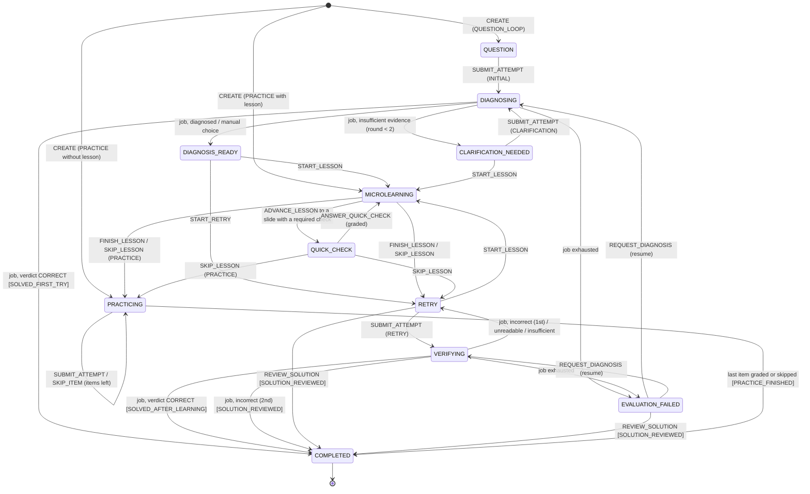
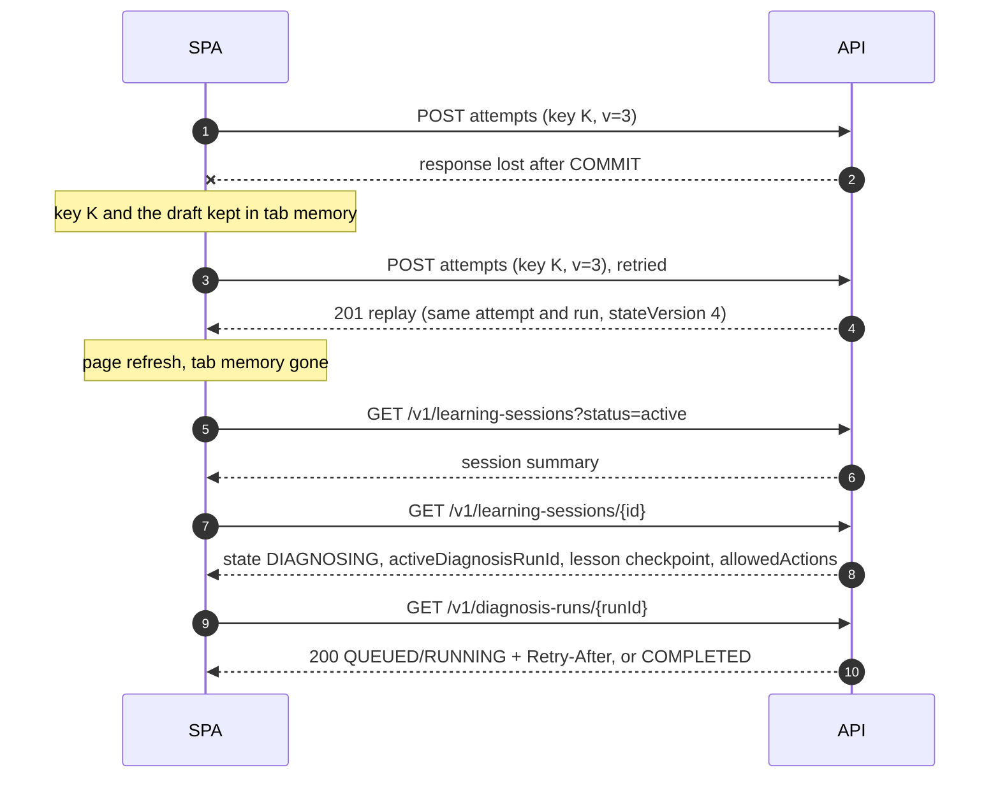

# 05 · Authoritative learning state machine

## 1. Principles

1. **The server owns learning state.** Opening a sheet, moving a slide, showing confetti or setting Vue `state.step = 7` changes nothing on the server. UI positions are *views* of a server state (§6).
2. Every state-changing request is a **command** with an `Idempotency-Key`. Commands that depend on the current state also carry `expectedStateVersion` (§4.1).
3. Asynchronous changes happen only through **job completions** (a diagnosis or verification finished or failed) and the **expiry sweeper**. Both are fenced by lease token, generation and state ([04 §7](04-postgresql-erd.md#7-concurrency-and-idempotency)).
4. `state_version` increments by exactly 1 on every state change and on every attempt submission. Updates that leave the state unchanged do not increment it, so they never cause stale-version conflicts. Examples: a slide position inside the same state, a hint, a tutor message, a UI checkpoint.
5. Anything not in the transition table (§4.2) is illegal: `409 INVALID_STATE_TRANSITION`, with **zero writes**. The session representation lists the commands that are legal right now (`allowedActions`), so clients never have to guess.

## 2. Session kinds

| Kind | Used by | Shape |
|---|---|---|
| `QUESTION_LOOP` | `/coba` funnel, `/challenge`, own questions from Tanya soal (blueprint D01: one engine) | Anchored on one question revision. Question → diagnosis → micro-lesson → quick check → retry → verification → completion. |
| `PRACTICE` | `/latihan/soal` (combined sets, bank items), `/core/:id` concept lessons with practice | Optional lesson (with quick checks), then a fixed, server-chosen list of items, then completion. In v1 every practice item is deterministically gradable (`MULTIPLE_CHOICE` or `NUMERIC`). |

## 3. State diagram

Two global transitions are left out of the drawing for readability:

- any non-terminal state → `ABANDONED` (command `ABANDON`);
- any non-terminal state → `EXPIRED` (sweeper, after `expires_at`).

`COMPLETED`, `ABANDONED` and `EXPIRED` are terminal. Learning again means a new session.

## 4. Commands and transitions

### 4.1 Commands and their endpoints

All paths are under `/v1` ([09](09-api-design.md), [openapi.yaml](openapi.yaml)).

| Command | Endpoint | `expectedStateVersion` | `Idempotency-Key` |
|---|---|---|---|
| `CREATE` | `POST /v1/learning-sessions` | — | required |
| `SUBMIT_ATTEMPT` | `POST /v1/learning-sessions/{sessionId}/attempts` | required | required |
| `ANSWER_QUICK_CHECK` | `POST /v1/learning-sessions/{sessionId}/quick-check-answers` | required | required |
| `START_LESSON`, `ADVANCE_LESSON`, `FINISH_LESSON`, `SKIP_LESSON`, `START_RETRY`, `SKIP_ITEM`, `ABANDON` | `POST /v1/learning-sessions/{sessionId}/actions` (`type` field) | required | required |
| `REVIEW_SOLUTION` | `POST /v1/learning-sessions/{sessionId}/solution` | required | required |
| `REQUEST_HINT` | `POST /v1/learning-sessions/{sessionId}/hints` | — (no state change) | required |
| `REQUEST_DIAGNOSIS` | `POST /v1/attempts/{attemptId}/diagnosis` (blueprint A01) | — (guarded by state) | required |
| `UPDATE_CHECKPOINT` | `PUT /v1/learning-sessions/{sessionId}/checkpoint` | — | — (`PUT` is idempotent) |
| Job completion, expiry | internal only | — | — |

The server derives the attempt `kind` from the state: `INITIAL` in `QUESTION`, `CLARIFICATION` in `CLARIFICATION_NEEDED`, `RETRY` in `RETRY`, and the item's role (`PRACTICE`/`TRANSFER`) in `PRACTICING`. Clients never send `kind`, `verdict`, `state`, `outcome`, `assistance` or mastery fields. Strict request schemas reject them (`400 VALIDATION_FAILED`).

### 4.2 Transition table

`E-xx` identifiers are referenced by the test matrix ([11](11-test-matrix.md)). *Guard* lists what is checked under the session lock. A failed guard returns `409 INVALID_STATE_TRANSITION` (or the stated code) and writes nothing.

| ID | Trigger | From | Guard | Effects (one transaction) | To |
|---|---|---|---|---|---|
| E-01 | `CREATE` (QUESTION_LOOP) | — | Learner `ACTIVE` with `GRANTED` `LEARNING_DATA` consent. The question revision is published in the current release, or is a private revision owned by the learner. | Insert session (`state_version` 1) and pin the release. Event `CONCEPT_VISITED` for the primary concepts. | `QUESTION` |
| E-02 | `CREATE` (PRACTICE) | — | As E-01. Items are resolved **server-side** from a spec (concept, set or item IDs). Every item is deterministically gradable. | Session, `session_item` rows in a fixed order (role `TRANSFER` or `PRACTICE`, [06 §5](06-diagnosis-evidence-mastery.md#5-eligibility-and-exposure)), optional `lesson_assignment` | `MICROLEARNING` or `PRACTICING` |
| E-03 | `SUBMIT_ATTEMPT` | `QUESTION` | Response non-empty, within size limits | Attempt `INITIAL` with its assistance snapshot. Diagnosis run generation 1, either evaluated inline (deterministic) or queued. | `DIAGNOSING`. An inline run falls through to E-05…E-09 in the same transaction. |
| E-04 | `SUBMIT_ATTEMPT` | `CLARIFICATION_NEEDED` | Fewer than 2 clarification rounds so far | Attempt `CLARIFICATION` (parent = the latest `INITIAL`) + run | `DIAGNOSING` |
| E-05 | job: insufficient evidence | `DIAGNOSING` | Lease, generation and active attempt match. Fewer than 2 clarification rounds. Also used for a self-report "Saya tahu caranya" (§4.4). | Run `COMPLETED` (`INSUFFICIENT_EVIDENCE`, clarification prompt). **No negative evidence.** | `CLARIFICATION_NEEDED` |
| E-06 | job: insufficient evidence, no rounds left, or self-report "belum tahu" | `DIAGNOSING` | As E-05 | Run `COMPLETED`. Recommendations are the question's primary concepts, most basic first, for the learner to choose. Blueprint D07: never an invented gap. | `DIAGNOSIS_READY` |
| E-07 | job: diagnosed, verdict ≠ `CORRECT` | `DIAGNOSING` | As E-05 | Evidence rows, run `COMPLETED`, recommendations, progress events | `DIAGNOSIS_READY` |
| E-08 | job: verdict `CORRECT` | `DIAGNOSING` | As E-05 | Evidence. Outcome `SOLVED_FIRST_TRY`. XP and mastery recomputed ([06](06-diagnosis-evidence-mastery.md)). | `COMPLETED` |
| E-09 | job exhausted (`deadline_at`, call budget or circuit open) | `DIAGNOSING`, `VERIFYING` | Lease matches | Run `FAILED` with `failure_code`. `resume_state` = the from-state. **No evidence.** | `EVALUATION_FAILED` |
| E-10 | `REQUEST_DIAGNOSIS` | `EVALUATION_FAILED` | The attempt is the session's active attempt. Generation < 3. Otherwise the call returns the existing run unchanged (A01: one shared run). | New run (generation + 1) for the same attempt | `resume_state` |
| E-11 | `START_LESSON {conceptId}` | `DIAGNOSIS_READY`, `CLARIFICATION_NEEDED`, `RETRY` | The concept is mapped on the anchor revision, and a published lesson teaches it. Otherwise `409 CONTENT_UNAVAILABLE`. | `lesson_assignment` with pinned checks. `assistance_event LESSON_VIEWED` (concept-level). | `MICROLEARNING` |
| E-12 | `ADVANCE_LESSON {slideIndex}` | `MICROLEARNING` | `0 ≤ slideIndex <` slide count | Update `slide_checkpoint`. A required, unanswered check on that slide changes the state. | `MICROLEARNING` or `QUICK_CHECK` |
| E-13 | `ANSWER_QUICK_CHECK` | `QUICK_CHECK` (required check), `MICROLEARNING` (optional check) | The check is pinned in this assignment, sits on the current slide and has no graded answer yet ("sekali jawab, terkunci") | Attempt `QUICK_CHECK`, graded inline. Evidence is **formative** and never mastery-eligible ([06 §5](06-diagnosis-evidence-mastery.md#5-eligibility-and-exposure)). | `MICROLEARNING` if graded. Unchanged if `UNREADABLE`. |
| E-14 | `FINISH_LESSON` | `MICROLEARNING` | Every required check has a `CORRECT` or `INCORRECT` answer | Assignment `COMPLETED`. Event `LESSON_COMPLETED`. `lesson_complete` projection. | `RETRY` (QUESTION_LOOP), `PRACTICING` (PRACTICE) |
| E-15 | `SKIP_LESSON` / `START_RETRY` | `SKIP_LESSON`: `MICROLEARNING`, `QUICK_CHECK`. `START_RETRY`: `DIAGNOSIS_READY`. | — | Assignment `SKIPPED` (if any). No completion credit. | `RETRY` (QUESTION_LOOP), `PRACTICING` (PRACTICE) |
| E-16 | `SUBMIT_ATTEMPT` | `RETRY` | `unsuccessful_retries < 2` (true by construction, see E-19) | Attempt `RETRY` (parent = the latest `INITIAL`). Verification run. | `VERIFYING` |
| E-17 | job: verdict `CORRECT` | `VERIFYING` | As E-05 | Evidence (never transfer-eligible, INV-13). Outcome `SOLVED_AFTER_LEARNING`. XP. | `COMPLETED` |
| E-18 | job: verdict `INCORRECT`, first time | `VERIFYING` | As E-05 | Evidence. `unsuccessful_retries` 0 → 1. Feedback and one hint in the run. | `RETRY` |
| E-19 | job: verdict `INCORRECT`, second time | `VERIFYING` | As E-05 | Evidence. `unsuccessful_retries` → 2. Outcome `SOLUTION_REVIEWED`. The solution becomes available (today's `max_tries` path). | `COMPLETED` |
| E-20 | job: `UNREADABLE` or insufficient evidence | `VERIFYING` | As E-05 | No negative evidence, no retry consumed (INV-16) | `RETRY` |
| E-21 | `REVIEW_SOLUTION` | `RETRY`, `EVALUATION_FAILED`, `COMPLETED` | — (always allowed in these states; it forfeits independent credit for the family) | `assistance_event FULL_SOLUTION_SHOWN` for the family (deduplicated per session). Returns the worked solution. From `RETRY`/`EVALUATION_FAILED`: outcome `SOLUTION_REVIEWED`. From `COMPLETED`: no state change and no version bump. | `COMPLETED` |
| E-22 | `SUBMIT_ATTEMPT` / `SKIP_ITEM` | `PRACTICING` | `sessionItemId` is the next `PENDING` item by ordinal | Attempt `PRACTICE` or `TRANSFER`, graded inline; item `ANSWERED` (or `SKIPPED`, without evidence). `UNREADABLE` keeps the item `PENDING`. | `PRACTICING`, or `COMPLETED` (`PRACTICE_FINISHED`) after the last item |
| E-23 | `REQUEST_HINT {step}` | `QUESTION`, `CLARIFICATION_NEEDED`, `RETRY`, `PRACTICING` | The step exists for the current question. Idempotent per `(session, question, step)`. | `assistance_event HINT_SHOWN` for the family. Returns the hint. **No state change and no version bump.** | same |
| E-24 | `ABANDON` | any non-terminal | — | Cancel queued and running jobs (adoption is fenced by state) | `ABANDONED` |
| E-25 | sweeper | any non-terminal | `expires_at < now()`. QUESTION_LOOP: 14 days after the last activity. PRACTICE: 24 hours. | Cancel jobs | `EXPIRED` |
| E-26 | `UPDATE_CHECKPOINT` | any non-terminal | The route is allow-listed | Store the UI checkpoint (advisory). No version bump. | same |

A clarification round is one `CLARIFICATION` attempt after the latest `INITIAL` attempt. The count comes from `question_attempt`, so it needs no extra column.

### 4.3 Tutor and solution exposure

Tutor messages (in any non-terminal state) **never change session state**. A tutor reply that contains a hint appends `assistance_event TUTOR_HINT`.

The tutor's "pembahasan lengkap" gate opens after two hints ([07 §7](07-ai-integration.md#7-tutoring-policy-no-direct-answers)). Passing it does the following:

- records `FULL_SOLUTION_SHOWN` for the family;
- makes `GET …/solution` readable for this session;
- leaves the state as it is.

Later attempts in the session are still graded, with `assistance = SOLUTION`, but they earn no XP and are not mastery-eligible (blueprint A04, INV-12). Ending the loop by reviewing the solution is the separate command E-21.

### 4.4 Self-reported responses

The question screen offers "Saya tahu caranya" and "belum tahu" buttons as well as a text field. These are sent as `StudentResponse {responseType: SELF_REPORT, selfReport: KNOW | DONT_KNOW}` ([03 §7](03-domain-model.md#7-value-objects-jsonb-schemas-versioned)). A self-report is **never** a verdict and never earns XP:

- `KNOW` → E-05. The clarification prompt asks for the formula or the first step, so the claim can be checked. Today's demo treats the claim as correct and awards XP. That behaviour ends with the facade ([09 §6](09-api-design.md#6-compatibility-with-the-current-frontend)).
- `DONT_KNOW` → E-06. Learning starts from the most basic primary concept. No evidence is written: not knowing is not a misconception.

### 4.5 Notable illegal transitions

All of these return `409 INVALID_STATE_TRANSITION` unless another code is named.

- Submitting a `RETRY` attempt from `DIAGNOSIS_READY` without E-15. The facade performs E-15 itself for legacy clients ([09 §6](09-api-design.md#6-compatibility-with-the-current-frontend)).
- Answering a quick check from another lesson, session or release, or answering one a second time after a graded answer.
- `ADVANCE_LESSON` while in `QUICK_CHECK`. The pending required check must be answered or the lesson skipped.
- `FINISH_LESSON` while a required check is unanswered or only `UNREADABLE`.
- `REVIEW_SOLUTION` before the retry phase: in `QUESTION`, `DIAGNOSING`, `CLARIFICATION_NEEDED`, `DIAGNOSIS_READY`, `MICROLEARNING`, `QUICK_CHECK` or `VERIFYING`.
- Any command on `ABANDONED` or `EXPIRED` (`410 SESSION_EXPIRED` for expired sessions). On `COMPLETED`, only `REVIEW_SOLUTION` is accepted. A late job result for a terminal session is discarded (§5.4).
- `SUBMIT_ATTEMPT` in `PRACTICING` for an item that is not the next pending one.

## 5. Concurrency, idempotency and interruption

### 5.1 Command protocol

The full protocol is in [04 §7](04-postgresql-erd.md#7-concurrency-and-idempotency). In order:

1. Authenticate and check consent.
2. Look up the idempotency key **before** the version check, so a replay with an old version still returns the original result.
3. Lock the session and compare `expectedStateVersion`.
4. Validate against the transition table.
5. Write.
6. Store the response.
7. Commit.

External calls never happen inside the transaction.

### 5.2 Duplicate submissions

| Situation | Behaviour |
|---|---|
| Double click or automatic HTTP retry, **same key and payload** | One attempt. The second request replays the stored `201` response, status and body. |
| Same key, different payload | `409 IDEMPOTENCY_KEY_REUSED`. Nothing written. |
| Second request while the first is still in its transaction | `409 IDEMPOTENCY_IN_PROGRESS` with `Retry-After: 1`. The client retries with the same key. |
| Two tabs, different keys, same `expectedStateVersion` | One wins. The other gets `409 STALE_STATE_VERSION` with `currentStateVersion`. The client reloads the session and the learner decides. It never resubmits automatically under a new key. |
| The same answer text submitted again later, on purpose | A new attempt if the state allows it. Text is never the deduplication key. |

### 5.3 Refresh, resume and network failure

- **Failure before commit:** nothing exists. A retry with the same key executes normally.
- **Failure after commit:** a retry with the same key replays the stored response. After a reload, `GET /v1/learning-sessions?status=active` finds the session. `GET /v1/learning-sessions/{id}` returns the state, the active run, the lesson checkpoint and `allowedActions`. Server state always beats a stale local copy.
- **Polling:** clients follow `Retry-After`. A pending run survives page reloads and server restarts because its job is durable. A completed run's representation includes the session's new `state` and `stateVersion`, so the client does not need an extra read before its next command.
- **Lesson resume (blueprint T02):** E-12 stores `lesson_assignment.slide_checkpoint`. After a refresh on slide 2, the client reopens slide 2.
- **Draft answers:** the client may keep an unsent draft in memory or `sessionStorage`, for the current tab only. Drafts are never sent without a user action, and they are cleared on logout.

### 5.4 Partial AI failures (blueprint D07)

| Failure | Handling | Learner sees | State |
|---|---|---|---|
| Provider timeout or 429/5xx/529 | The worker retries inside the job: at most 2 more provider calls per job, exponential backoff with full jitter, honouring `retry-after`, all before `deadline_at`. **This is the only retry layer.** The SDK does not retry, and the client does not resubmit ([07 §5](07-ai-integration.md#5-reliability-timeouts-retries-and-failure-handling)). | "Analisis butuh waktu lebih lama. Kamu bisa menunggu atau lanjut belajar." | `DIAGNOSING` |
| Repeated provider errors | The circuit breaker opens. Deterministic evaluation still runs where the rubric covers the response. New AI work fails fast with `failure_code = DEPENDENCY_UNAVAILABLE`. | "Analisis sedang tidak tersedia. Kamu tetap bisa belajar." | `EVALUATION_FAILED` (resumable with E-10) |
| Invalid structured output | Reject it and log the validation error (never the text). At most one schema-repair call, counted in the call budget. Then fail. | "Hasil analisis belum bisa ditampilkan. Coba lagi atau pilih inti sendiri." | `EVALUATION_FAILED` |
| Valid schema, unsupported claims (spans not in the response, concepts not mapped) | Drop the offending items. If nothing actionable remains, the run is `INSUFFICIENT_EVIDENCE`. | A clarification request | `CLARIFICATION_NEEDED` |
| Refusal (`stop_reason: refusal`) | No retry with the same input. Deterministic fallback, or `INSUFFICIENT_EVIDENCE`. | A neutral message | As above |
| Late result after `ABANDON`, expiry, a new generation, consent revocation or deletion | The adoption check fails under lock. The result is discarded; its cost is still recorded. | — | unchanged |

**A fallback never invents a gap.** Without supported evidence, the outcome is `INSUFFICIENT_EVIDENCE` or a concept the learner chooses, never a guessed misconception (D07).

### 5.5 Login in the middle of a loop (guest → account)

Guests run the loop on their device ([08 §5](08-auth-security-privacy.md#5-device-guest-to-account-migration)). After a verified login **and** granted consent:

1. The client offers "Simpan perjalanan dari perangkat ini?". On yes, it calls `POST /v1/me/device-imports` with the device session summary and one `Idempotency-Key`.
2. The server creates a `QUESTION_LOOP` session with `origin = DEVICE_IMPORT`. It stores the device session ID in `legacy_client_session_id`, and the device's initial response as an imported attempt (`source = DEVICE_IMPORT`, **never eligible**, INV-21). It places the session in the authoritative state that matches how far the device got:
   - before the diagnosis → `QUESTION`;
   - diagnosis seen → `DIAGNOSIS_READY`;
   - lesson finished → `RETRY` (and the concept's `lesson_complete` is set; it is a presentation fact, not evidence);
   - completed → `COMPLETED`, with the outcome marked as imported.
3. The client resumes at the returned session and checkpoint, not at `/home` (blueprint A05). From here on, every attempt is graded by the server.
4. The same import key replays the same session. Importing the same device session ID again, under another key or by **another account** (a shared school computer), returns `409 ALREADY_IMPORTED`. The existing session ID is returned only to its owner. A partial unique index on imported sessions enforces this ([04 §4](04-postgresql-erd.md#4-learning-assessment-progress-tutor-and-intake-tables)), so one learner's device history can never land in another learner's account.

Because the imported session carries the device's session ID, a legacy client that keeps using the facade with that ID continues the same server session.

### 5.6 Other interruptions

| Event | Effect |
|---|---|
| `LEARNING_DATA` consent revoked | Learner → `DELETION_PENDING`, and erasure starts with reason `CONSENT_REVOKED` ([08 §6](08-auth-security-privacy.md#6-retention-deletion-and-learner-rights)). Commands → `403 CONSENT_REQUIRED`. Jobs are cancelled, and late results are discarded. |
| `AI_PROCESSING` consent revoked | Queued AI jobs are cancelled. Their runs fail with `failure_code = CONSENT_REVOKED`, and the session moves to `EVALUATION_FAILED`. E-10 then runs deterministic evaluation only. The tutor becomes unavailable. |
| Deletion requested | `DELETION_PENDING` immediately. Every command → `403`. Erasure proceeds ([04 §8](04-postgresql-erd.md#8-retention-and-deletion)). |
| New curriculum release published | Existing sessions keep their pinned release and revisions. New sessions use the new release. |
| Server deploy or restart | Jobs are durable, leases expire and are recovered, and no state lives in memory. |

## 6. UI screens → backend states

The UI may show several screens for one state, and some screen changes are purely local.

| Screen (Figma) | Backend state | Command or read | UI-only parts |
|---|---|---|---|
| S1 Soal | `QUESTION` | `GET session` | — |
| S2 Petunjuk (hint walk) | `QUESTION` | `REQUEST_HINT` (records the exposure) | Switching tabs inside the hint |
| S3 Mengecek | `DIAGNOSING` | `GET diagnosis-run` (polling) | The scan animation |
| S4 Diagnosis | `DIAGNOSIS_READY`, or `COMPLETED` when fully correct | `GET diagnosis-run` | "Hasil keliru? Laporkan" → `POST /v1/diagnosis-runs/{id}/reports` ([06 §9](06-diagnosis-evidence-mastery.md#9-auditability-and-disputes)) |
| S5 Materi 1/2 | `MICROLEARNING` | `START_LESSON`, `ADVANCE_LESSON` | — |
| S6 Materi 2/2 + check | `QUICK_CHECK` → `MICROLEARNING` | `ANSWER_QUICK_CHECK`, then `FINISH_LESSON` | — |
| S7 Ulangi soal tadi | `RETRY` → `VERIFYING` | `SUBMIT_ATTEMPT`, `REVIEW_SOLUTION` | — |
| S8 Berhasil | `COMPLETED` | `GET session`, `GET /v1/me/stats`, optional `REVIEW_SOLUTION` (compare) | Confetti |
| S9 Daftar | — (identity) | `POST /v1/auth/start` | Not a learning state |
| S10 Kenalan | — (profile) | `PATCH /v1/me/profile` | Not a learning state |
| I1/I2 IntiBot | any non-terminal | Tutor API | No state change |
| A4 → Latihan inti, A5 Soal gabungan | `PRACTICE`: `MICROLEARNING`/`QUICK_CHECK`/`PRACTICING` | `CREATE`, `SUBMIT_ATTEMPT`, `SKIP_ITEM` | — |
| T5/T6 Kerjakan / Diagnosis soalmu | `QUESTION_LOOP` (origin `INTAKE`) | Same as S1–S8 | — |
