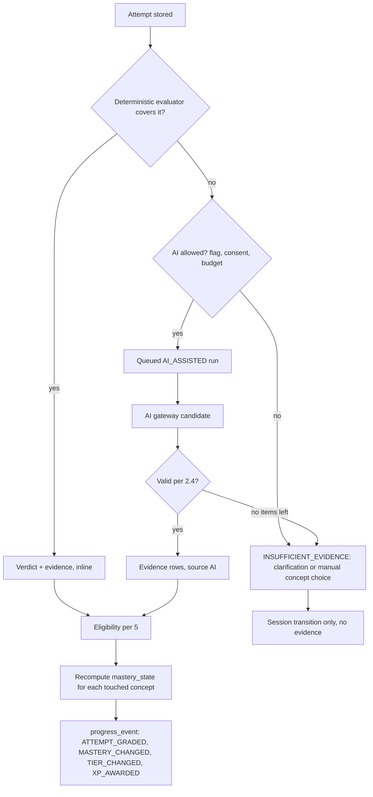

# 06 · Diagnosis, evidence and mastery

This document defines what the system may conclude from a learner's answer, who may conclude it, and how conclusions become mastery. Three rules hold throughout:

- **The model proposes; rules decide.** An AI output is a candidate that the `assessment` module validates. Only `progress` derives mastery, and it uses only eligible evidence ([02 §4](02-system-architecture.md#4-deterministic-rules-vs-probabilistic-inference)).
- **No evidence, no claim.** When the response does not show enough, the answer is "insufficient evidence", never a guessed gap (blueprint D07).
- **One wrong answer is not a verdict on the learner.** Mastery moves only on patterns of eligible evidence, and a demonstrated concept is revoked only by repeated contradicting evidence (§6).

## 1. Verdicts and evidence classifications

Two different things are recorded and must not be confused (blueprint D04):

| Level | Field | Values | Meaning |
|---|---|---|---|
| Attempt | `question_attempt.verdict` | `PENDING`, `CORRECT`, `INCORRECT`, `UNREADABLE`, `NOT_GRADED` | Was this answer to this question right? Drives the state machine ([05](05-learning-state-machine.md)). `NOT_GRADED` is used for self-reports and for items without a gradable answer. |
| Concept, per run | `concept_evidence.classification` | see below | What does this answer show about **one** concept? Drives mastery. |

| Classification | Definition | Requires |
|---|---|---|
| `UNDERSTANDING_DEMONSTRATED` | The response contains a correct, attributable use of the concept: a matched step on a valid solution path, or a correct final answer that every valid path to it requires. | ≥ 1 reference (§2.4) |
| `MISCONCEPTION_EVIDENCED` | The response contains an attributable error in the concept, preferably matching a catalogued misconception of that concept. | ≥ 1 reference and a rationale ≤ 400 characters (DB `CHECK`) |
| `INSUFFICIENT_EVIDENCE` | The concept is assessable on this item, but the response does not show enough to decide. Examples: only part of the working, ambiguous notation, low confidence. | An uncertainty reason |
| `NOT_ASSESSED` | This response does not exercise the concept. Examples: the learner chose another valid solution path (K01), or never reached that step. | — |

A run's `evidence_status` is `SUPPORTED` when at least one row is `UNDERSTANDING_DEMONSTRATED` or `MISCONCEPTION_EVIDENCED`, and `INSUFFICIENT_EVIDENCE` otherwise.

**A different valid strategy is never a mistake** (blueprint K01). Concepts that only belong to paths the learner did not take are `NOT_ASSESSED`, not `MISCONCEPTION_EVIDENCED`.

## 2. Diagnosis contract

### 2.1 Inputs

The evaluator receives exactly this context, assembled server-side from IDs. The client never supplies it.

| Input | Source | Notes |
|---|---|---|
| Question revision: body, rubric (private), `item_type`, `context_tag` | `question_revision` pinned on the attempt | The rubric holds `solutionPaths[]`, per-step concept mapping, accepted forms, the final-answer evidence list and the misconception map ([03 §7](03-domain-model.md#7-value-objects-jsonb-schemas-versioned)). |
| Mapped concepts with K03 data (definition, objectives, misconception codes) | `question_concept` + `concept` | Only concepts mapped on this revision may appear in the output. |
| Response | `question_attempt.response` | Redacted before any AI call ([07 §6](07-ai-integration.md#6-privacy-and-safety-for-minors)). |
| Parent response | The latest `INITIAL` attempt, only for `CLARIFICATION` and `RETRY` | So "you changed sin to tan" can be said. |
| Assistance snapshot | `question_attempt.assistance` | Used for eligibility (§5), never for correctness. |

**Excluded on purpose:** identity, profile, age band, other sessions, mastery state and previous diagnoses of other questions. Seeing a learner's history invites confirmation bias. Mastery is computed from evidence later; it is not an input to grading.

### 2.2 Output (`diagnosis-result.v1`)

Every engine produces the same internal structure. The AI engine produces it as a candidate through structured outputs ([07 §3](07-ai-integration.md#3-prompts-schemas-and-structured-output)).

```json
{
  "schemaVersion": 1,
  "verdict": "INCORRECT",
  "evidenceStatus": "SUPPORTED",
  "solutionPathCode": "TAN_DEPRESSION",
  "concepts": [
    {
      "conceptId": "0192f6c4-…",
      "classification": "MISCONCEPTION_EVIDENCED",
      "misconceptionCode": "RATIO_CHOICE",
      "confidence": null,
      "uncertaintyReasons": [],
      "refs": [{ "kind": "SPAN", "start": 0, "end": 6, "quote": "sin 30" }],
      "rationale": "sin memakai sisi miring, padahal yang diketahui sisi depan dan samping."
    }
  ],
  "clarificationPrompt": null,
  "feedback": {
    "headline": "Hampir! Meleset sedikit di 1 inti.",
    "lede": "Pilihan perbandingannya yang meleset."
  }
}
```

The persisted form is one `diagnosis_run` row plus one `concept_evidence` row per concept ([04 §4](04-postgresql-erd.md#4-learning-assessment-progress-tutor-and-intake-tables)). The API representation (`DiagnosisRun` in [openapi.yaml](openapi.yaml)) adds titles, legacy aliases and recommendations. It never exposes the rubric, the raw confidence number, provider payloads or chain of thought.

### 2.3 Engines and how one is chosen

| Engine | Evaluators (rubric `evaluator`) | Used for | Produces |
|---|---|---|---|
| `DETERMINISTIC` | `option-v1` (multiple choice), `numeric-v1` (numbers with tolerance and accepted forms such as `20√3 ≈ 34,64`), `tower-v1` (authored branch rules, ported from today's `services/analysis.ts`), further authored pattern evaluators | Catalog items, quick checks, practice | Verdict plus step-level evidence where the rubric's patterns match |
| `AI_ASSISTED` | `ai-assisted-v1` through the AI gateway ([07](07-ai-integration.md)) | Free-text working that no deterministic pattern covers, and own questions from intake | Candidate evidence, validated by §2.4. **Never mastery-eligible** (INV-10). |
| `EDUCATOR` | Staff review | Upheld disputes (§9.3) | Regrade run with superseding evidence |

Selection for each run:

1. Run the deterministic evaluator. If it yields a verdict and covers the response, finish **inline** in the submit transaction ([05 E-03](05-learning-state-machine.md#42-transition-table)).
2. Otherwise, if `ai.diagnosis.enabled` is on, the learner has `GRANTED` `AI_PROCESSING` consent, and budget is available, queue an `AI_ASSISTED` run.
3. Otherwise complete the run as `INSUFFICIENT_EVIDENCE` with a clarification prompt, or with a manual concept choice ([05 E-05/E-06](05-learning-state-machine.md#42-transition-table)).

When both engines run on one response, the **deterministic verdict on the final answer always stands**. The AI may add step-level evidence about the working; it may not overturn a rubric-checked answer.

AI-graded verdicts (own questions without an authored rubric) drive the state machine but earn **no XP** (§7). A prompt-injected "mark this correct" therefore buys nothing.

### 2.4 Validation of AI candidates

A candidate is accepted only after all of these checks, in this order. A failing item is dropped and the reason is logged as a code, never as text.

1. **Schema:** the output parses against `diagnosis-result.v1`. Bounds that structured outputs cannot enforce are re-checked in code: string lengths, array sizes, numeric ranges ([07 §3](07-ai-integration.md#3-prompts-schemas-and-structured-output)).
2. **Concept scope:** every `conceptId` is mapped on this revision. `UNDERSTANDING_DEMONSTRATED` and `MISCONCEPTION_EVIDENCED` also require `assessable = true` (INV-09).
3. **Misconception codes:** each code exists on that concept in the pinned release.
4. **References:**
   - `SPAN`: `0 ≤ start < end ≤ length(response)`, and `quote` equals that substring after whitespace normalisation;
   - `OPTION`: the option exists on the revision;
   - `STEP`: the path and step exist in the rubric.
5. **Required support:** a misconception needs ≥ 1 reference and a rationale. Understanding needs ≥ 1 reference.
6. **Confidence floor:** an AI item below the configured floor becomes `INSUFFICIENT_EVIDENCE` with reason `LOW_CONFIDENCE`. The floor starts at 0.7 and is calibrated on the gold set ([07 §8](07-ai-integration.md#8-evaluation-before-launch)).
7. **Feedback filters:**
   - no final answer before the retry phase (the rubric's final-answer forms are matched and blocked);
   - no statements about the learner as a person;
   - length limits: headline ≤ 120, lede ≤ 240, clarification ≤ 240 characters.
8. **Outcome:** if no `UNDERSTANDING_DEMONSTRATED` or `MISCONCEPTION_EVIDENCED` item survives, the run completes as `INSUFFICIENT_EVIDENCE`.

### 2.5 Confidence and uncertainty

- `confidence` is stored only for AI items. It is the model's self-report, **not a calibrated probability**. It is used for the floor in §2.4 and for audit, never shown as a number and never used in mastery.
- Deterministic and educator rows have `confidence = NULL`. Their certainty is about the rule match, not about the learner's mind.
- `uncertainty_reasons` uses a closed list: `AMBIGUOUS_NOTATION`, `INCOMPLETE_WORK`, `ALTERNATIVE_PATH`, `LOW_CONFIDENCE`, `UNREADABLE_INPUT`, `OUT_OF_SCOPE`.

### 2.6 What learner-facing explanations may say

| Allowed | Not allowed |
|---|---|
| What the response shows: "Kamu memakai sin, padahal yang diketahui sisi depan dan samping." | Statements about the person: "kamu lemah di trigonometri", "kamu lambat" |
| What is not yet visible: "Langkahmu belum cukup terlihat untuk dicek." | Claims beyond the evidence, or a guessed gap |
| The next step and the concept to learn | The final answer before the retry phase |
| That AI helped, when it did ("Dianalisis dengan bantuan AI") | Comparisons with other learners, scores out of 100, predictions of exam results |

Every diagnosis screen offers "Hasil keliru? Laporkan" (§9.3). Copy is Indonesian, short and neutral.

## 3. Evidence sources and non-evidence

| Source | Produces evidence? | Mastery-eligible? |
|---|---|---|
| Deterministic evaluators | Yes | Yes, subject to §5 |
| AI-assisted diagnosis | Yes (validated candidates) | **No** (INV-10). An `EDUCATOR` review can confirm it with a new row. |
| Educator regrade | Yes (supersedes earlier rows) | Yes, subject to §5 |
| Quick checks in lessons | Yes, `QUICK_CHECK` attempts | **No.** They are formative and only show the lesson is landing. |
| Self-reports ("Saya tahu caranya", "belum tahu") | No | — |
| Device history imported after login | The response is stored as an imported attempt | **No** (INV-21) |
| Tutor conversations | No. They only create exposure events. | — |
| Product analytics (`track.ts`) | No | — |

## 4. From attempt to mastery



Evidence insertion, mastery recomputation and progress events happen in **one transaction**, under the lock order in [04 §7](04-postgresql-erd.md#7-concurrency-and-idempotency).

## 5. Eligibility and exposure

### 5.1 Mastery eligibility

`concept_evidence.mastery_eligible` is true only when **all** of these hold. Every failing rule adds its code to `eligibility_reasons`, so the decision is explainable later.

| # | Rule | Reason code when it fails |
|---|---|---|
| 1 | Classification is `UNDERSTANDING_DEMONSTRATED` or `MISCONCEPTION_EVIDENCED` | `NOT_A_CLAIM` |
| 2 | Source is `DETERMINISTIC` or `EDUCATOR` | `AI_ONLY` |
| 3 | The attempt was live, not imported | `DEVICE_IMPORT` |
| 4 | The attempt is not a quick check | `FORMATIVE_CHECK` |
| 5 | No `FULL_SOLUTION_SHOWN` or `FINAL_ANSWER_SHOWN` for this question family before the attempt was submitted | `SOLUTION_SEEN` |
| 6 | The concept is `assessable` on the revision | `NOT_ASSESSABLE` |
| 7 | The row has not been superseded by a regrade | `SUPERSEDED` (set on the old row when superseded; the projection ignores it) |

### 5.2 Transfer eligibility (input to K05)

`transfer_eligible` requires mastery eligibility plus:

| # | Rule | Reason code when it fails |
|---|---|---|
| 1 | The attempt kind is `TRANSFER`, meaning it answers a `session_item` with role `TRANSFER`. The anchor of a question loop, its clarifications and its retries never qualify (INV-13). | `ANCHOR_OR_RETRY` / `NOT_TRANSFER_ITEM` |
| 2 | No `HINT_SHOWN` or `TUTOR_HINT` for this family before submission | `HINT_USED` |
| 3 | The family was fresh: the learner had no earlier attempt on any question of this family | `FAMILY_NOT_FRESH` |

Lessons do **not** block transfer. Learning a concept and then applying it to an unseen question is exactly what transfer measures. `LESSON_VIEWED` is recorded for analysis only.

How transfer items are chosen: when a `PRACTICE` session is created (E-02), an item gets role `TRANSFER` if its family is fresh for the learner and it maps the focus concept as `PRIMARY` and assessable. Other items get role `PRACTICE`. Eligibility is checked again at grading, because a hint may be used between creation and submission.

### 5.3 Exposure events (blueprint A04)

Exposure **never changes a verdict** (INV-12). It changes only what the verdict may count for.

| `assistance_event.type` | Recorded when | Scope | Effect |
|---|---|---|---|
| `HINT_SHOWN` | `POST …/hints` delivers a hint step (server-delivered), or the legacy facade receives `hintOpened: true` (client-reported, conservative) | Family | Blocks transfer for the family |
| `TUTOR_HINT` | A tutor reply with intent `HINT` is delivered | Family | Blocks transfer for the family |
| `LESSON_VIEWED` | `START_LESSON` | Concept | None (analysis only) |
| `FINAL_ANSWER_SHOWN` | The server reveals a key after grading (for example `correctOptionIndex`) | Family | Blocks mastery eligibility and XP for later attempts in the family |
| `FULL_SOLUTION_SHOWN` | `REVIEW_SOLUTION` (E-21) or the tutor's solution gate ([05 §4.3](05-learning-state-machine.md#43-tutor-and-solution-exposure)) | Family | Same as above |

`question_attempt.assistance` stores the strongest exposure in effect at submission (`NONE` < `LESSON` < `HINT` < `TUTOR` < `SOLUTION`), so an attempt can be explained without replaying events.

## 6. Mastery policy (`mastery-v1`)

`mastery_state` is a projection per `(learner, concept)`. It is recomputed from evidence in the same transaction as new evidence, and it can be rebuilt from scratch (INV-11). AI never writes it.

### 6.1 Status

| Status | Rule |
|---|---|
| `NOT_ASSESSED` | No mastery-eligible evidence for the concept |
| `DEVELOPING` | At least one mastery-eligible row, and the K05 condition below is not met (or was revoked) |
| `DEMONSTRATED` | The K05 condition was met and has not been revoked |

### 6.2 K05: when a concept counts as demonstrated

Let *T* be the learner's transfer-eligible, non-superseded evidence rows for the concept, ordered by the attempt's server `submitted_at` (ties broken by attempt ID, which is time-ordered).

The concept becomes `DEMONSTRATED` when the **last three rows of T** satisfy all of:

1. all three are `UNDERSTANDING_DEMONSTRATED` (3/3, consecutive);
2. they come from three distinct question families;
3. they cover at least two distinct `context_tag` values (for example `MENARA`, `TANGGA`, `BAYANGAN`);
4. at least one of them was answered in a different session, at least 24 hours after the first of the three.

Derived fields:

- `transfer_streak` = length of the trailing run of `UNDERSTANDING_DEMONSTRATED` rows in *T*, capped at 3;
- `transfer_correct_total` = all `UNDERSTANDING_DEMONSTRATED` rows in *T*;
- `qualifying_contexts` = distinct context tags in the trailing streak;
- `last_practiced_at` = submission time of the latest mastery-eligible row.

### 6.3 Failure, contradiction and decay

- **Before demonstration:** an eligible `MISCONCEPTION_EVIDENCED` row in *T* resets `transfer_streak` to 0. The status stays `DEVELOPING` (never back to `NOT_ASSESSED`), and the next diagnosis recommends remediation for that misconception (K05).
- **After demonstration:** one eligible misconception in *T* sets `needs_review = CONTRADICTION` and keeps `DEMONSTRATED`. The status is revoked to `DEVELOPING` (and `demonstrated_at` cleared, with a `MASTERY_CHANGED` event) only when at least two of the last three rows of *T* are misconceptions. A single wrong answer never erases demonstrated mastery.
- **Staleness:** a nightly projection job sets `needs_review = STALE_14D` for concepts at tier ≥ 2 whose `last_practiced_at` is older than 14 days. This matches the "goyah" signal the frontend already derives from `lastPracticedAt`. An eligible correct answer clears it and earns `SEGARKAN` XP (§7).
- **Retention:** when raw answer text is purged after 180 days, the evidence rows remain, so mastery never changes because of a purge ([04 §8](04-postgresql-erd.md#8-retention-and-deletion)).

### 6.4 Other projection fields

| Field | Set when |
|---|---|
| `exploration = VISITED` | A session is created with the concept as primary or focus concept, or a lesson for it is opened (`CONCEPT_VISITED` event) |
| `lesson_complete` | `FINISH_LESSON` for a lesson that teaches the concept (`LESSON_COMPLETED`), or an imported device session that reached the end of the lesson (`DEVICE_HISTORY_IMPORTED`). It is a presentation fact, not evidence. |
| `practiced` | Any mastery-eligible row from a `PRACTICE` or `TRANSFER` attempt |

### 6.5 UI tiers (single server rule for both APIs)

The server computes `ui_tier`, and both the canonical `/v1/me/mastery` and the legacy `/v1/me/progress` derive from it. The rule reproduces what the shipped frontend computes for signed-in learners (`useLearnerView.tierOf`), so the two can never disagree.

| `ui_tier` | Label | Rule |
|---|---|---|
| -1 | — | No record at all |
| 0 | Dicoba | Visited, lesson completed, or evidence exists, but **no** mastery-eligible `UNDERSTANDING_DEMONSTRATED` row |
| 1 | Kenal | At least one mastery-eligible correct row, and `transfer_correct_total = 0` |
| 2 | Mahir | `DEVELOPING` and `transfer_correct_total ≥ 1` |
| 3 | Kuasai | `DEMONSTRATED` |

Tier 2 needs one independent, unassisted correct answer on an unseen family. It never drops on a later mistake: the streak toward Kuasai resets instead, and remediation is recommended. The frontend's tier copy must follow the server rule: "Benar di 2 soal berbeda" becomes "Benar di soal baru tanpa bantuan", and "Benar lagi setelah ≥7 hari" becomes "3 soal baru berturut-turut, salah satunya di sesi lain ≥24 jam kemudian" ([12](12-implementation-roadmap.md)).

The legacy projection is lossy for one case: a concept with only misconception evidence is `DEVELOPING` canonically but tier 0. `/v1/me/progress` therefore reports it as `NOT_ASSESSED` + `VISITED`, and the shipped profile chip shows "Belum dinilai" for it. This is documented in [09 §6](09-api-design.md#6-compatibility-with-the-current-frontend) and disappears when the frontend reads `/v1/me/mastery`.

## 7. XP, streaks and missions

All XP is awarded by the server as `progress_event` rows of type `XP_AWARDED` with a deterministic `event_key`. `UNIQUE (learner_id, event_key)` makes double awards impossible (INV-15). The values are the ones in today's `data/gamification.ts`.

| Rule | XP | `event_key` | Awarded when |
|---|---|---|---|
| `SOAL_BENAR` | 10 | `xp:SOAL_BENAR:<familyCode>` | The first XP-eligible `CORRECT` verdict on any question of the family |
| `SOAL_GABUNGAN` | 20 | `xp:SOAL_GABUNGAN:<familyCode>` | Same, for a combined question: assessable concepts from ≥ 2 topics (K02). Replaces `SOAL_BENAR`. |
| `TUNTAS_SETELAH_BELAJAR` | 30 | `xp:TUNTAS:<sessionId>` | A question loop ends `SOLVED_AFTER_LEARNING`, the initial diagnosis evidenced a misconception, and a lesson was completed (not skipped) in the session |
| `NAIK_TINGKAT` | 15 | `xp:NAIK_TINGKAT:<conceptId>:<tier>` | `ui_tier` reaches a value from 1 to 3 for the first time |
| `SEGARKAN` | 5 | `xp:SEGARKAN:<conceptId>:<localDate>` | An eligible correct answer on a concept with `needs_review`, once per concept per day |
| `MISI_HARIAN` | 30 | `xp:MISI_HARIAN:<localDate>` | All of the day's missions are complete |

A `CORRECT` verdict is **XP-eligible** only when:

- its run's engine is `DETERMINISTIC` or `EDUCATOR`;
- the attempt is live (not imported), not a self-report and not a quick check;
- there is no `FULL_SOLUTION_SHOWN` or `FINAL_ANSWER_SHOWN` for the family before submission.

Hints do not remove XP: answering correctly with a hint is still learning. Seeing the solution does.

**Streaks.** A local date is active when the learner has an XP-eligible graded attempt or a completed lesson on it, in the timezone from `student_profile` (`Asia/Jakarta` by default). The first activity of a date appends `STREAK_EXTENDED`. Streak freezes (at most 2 banked, `STREAK_FREEZE_USED`) are supported by the schema but disabled by default (`stats.streakFreeze.enabled = false`) until the product decision in [12](12-implementation-roadmap.md) is made.

**Missions.** The server mirrors today's daily missions: "Kerjakan 2 soal" (two XP-eligible correct answers), then "Segarkan 1 inti yang goyah" if a concept needs review, otherwise "Coba 1 soal gabungan", and "Pelajari 1 inti baru" (a first `LESSON_COMPLETED` for a concept). Each completed mission appends `MISSION_COMPLETED`, and all three award `MISI_HARIAN`. There are no lives, public leaderboards, loot boxes or guilt notifications, consistent with the current product principles and with PP 17/2025's ban on manipulative design ([08 §7](08-auth-security-privacy.md#7-indonesian-legal-baseline-reviewed-sources)).

`learner_stats` is recomputed under a row lock from these events and is rebuildable (INV-11).

## 8. Verification by reattempt

| Step | What it verifies | Counts as |
|---|---|---|
| Quick checks in the lesson (E-13) | The lesson is landing | Formative only |
| Retry of the same question (E-16/E-17) | The diagnosed misconception is resolved **on this question** | Mastery-eligible (unless the solution was seen), never transfer (INV-13). Can lift the concept to Kenal. |
| Transfer items in later practice (E-22) | The understanding carries to unseen questions | The only input to K05 |

After `SOLVED_AFTER_LEARNING`, the completed session recommends a short practice set for the concept, and suggests trying it again on another day, which is the spacing condition of K05. After two unsuccessful retries (E-19), the evidence is kept, the concept stays `DEVELOPING`, and the recommendation points to the concept's hard prerequisites. `UNREADABLE` and insufficient-evidence retries never consume an allowance (INV-16).

## 9. Auditability and disputes

### 9.1 What every conclusion carries

- Evidence rows: run, attempt, engine (via the run), `rubric_version`, `policy_version`, `solution_path_code`, references, `eligibility_reasons`.
- AI runs, in addition: `prompt_version`, `model`, schema version, and `provenance.invocationIds` pointing at `ai_invocation` rows with tokens, cost and latency.
- Never stored: chain of thought, raw prompts, provider payloads.

### 9.2 Replay and policy changes

- `mastery_state` and `learner_stats` can be rebuilt from evidence, events and the policy version by a `projection` job. A CI property test compares incremental and rebuilt projections for random event orders (INV-11, [11](11-test-matrix.md)).
- A policy change (for example `mastery-v2`) is a new version with a rebuild migration. History is never edited.
- A regrade happens only through a new diagnosis generation with engine `EDUCATOR`. Its evidence rows set `supersedes_id`. Old rows stay for audit and are excluded from projections.

### 9.3 Disputes ("Hasil keliru? Laporkan")

1. `POST /v1/diagnosis-runs/{id}/reports` stores a `diagnosis_report` (`OPEN`) with a reason code (`ANSWER_WAS_CORRECT`, `WRONG_CONCEPT`, `UNCLEAR_EXPLANATION`, `OTHER`) and an optional note of at most 500 characters. One report per run.
2. Staff review it in the admin tool. The review is audited (`audit_event`).
3. Outcomes:
   - `UPHELD` with a regrade: an `EDUCATOR` run supersedes the disputed evidence (and verdict, if needed), and projections are recomputed. A streak wrongly reset is restored, and XP that becomes due is awarded.
   - `UPHELD` without a regrade (for example an unclear explanation): the content is queued for revision.
   - `REJECTED`: nothing changes.
4. The learner sees the outcome in the app. The note is purged by the retention rule in [04 §8](04-postgresql-erd.md#8-retention-and-deletion).
5. While a report is `OPEN`, the disputed evidence keeps counting, so filing a report cannot be used to game mastery.

This is the human-review safeguard for diagnostic profiling of children ([08 §7](08-auth-security-privacy.md#7-indonesian-legal-baseline-reviewed-sources)). The proposed review target is 5 school days, pending staffing.

## 10. Worked example: the tower question

The `/coba` question: a 20 m tower is seen from a point at a 30° angle of depression; find the horizontal distance. Concept aliases as in today's map: `tri-c` (naming sides), `tri-d` (definition of sin, cos, tan), `tri-f` (special angles). Misconception codes are illustrative; the reviewed catalog defines the real ones.

| Response | Engine | Verdict | Evidence | Next state |
|---|---|---|---|---|
| `tan 30 = 20/x, x = 20√3` | `tower-v1` | `CORRECT` | `tri-c`, `tri-d`, `tri-f`: understanding (spans `tan 30`, `20/x`, `20√3`) | `COMPLETED` (`SOLVED_FIRST_TRY`) |
| `34,6` (final value only) | `tower-v1` | `CORRECT` | Only the concepts every valid path requires (rubric `finalAnswerEvidence`): understanding. Others: `NOT_ASSESSED`. | `COMPLETED` |
| `sin 30 = 20/x` | `tower-v1` | `INCORRECT` | `tri-d`: misconception `RATIO_CHOICE`, span `sin 30`. `tri-f`: `NOT_ASSESSED`. | `DIAGNOSIS_READY` |
| `tan 30 = 1/2, …` | `tower-v1` | `INCORRECT` | `tri-d`: understanding. `tri-f`: misconception `SPECIAL_VALUE`, span `1/2`. | `DIAGNOSIS_READY` |
| `40` (wrong value, no working) | `tower-v1` | `INCORRECT` | Every concept `INSUFFICIENT_EVIDENCE` (`INCOMPLETE_WORK`). A wrong number alone does not show *which* concept failed (blueprint T01 #3). | `CLARIFICATION_NEEDED` |
| "belum tahu" (self-report) | — | `NOT_GRADED` | None. Recommendation: learn `tri-d` first. | `DIAGNOSIS_READY` |
| "Saya tahu caranya" (self-report) | — | `NOT_GRADED` | None. Clarification: "Tulis rumus atau langkah pertamamu." | `CLARIFICATION_NEEDED` |
| Free text no pattern covers | `ai-assisted-v1` with consent, otherwise none | Deterministic final-answer check if present | AI rows (not mastery-eligible) or `INSUFFICIENT_EVIDENCE` | `DIAGNOSIS_READY` or `CLARIFICATION_NEEDED` |

A combined item shows the same discipline across topics. Bank item `gab-pangkat-cos60` asks for 2³ × cos 60°. The option that results from computing 2³ as 6 maps, through the rubric's misconception map, to an exponent misconception on `eks-b` (the blueprint's EXP-01). `tri-f` is `NOT_ASSESSED` for that option, so the trigonometry concept is not blamed (blueprint T01 #2). The item's exponent–trigonometry link is a `QUESTION_APPLICATION`, not a prerequisite edge (K02).

Today's `services/analysis.ts` already encodes the first four rows and the "show it first" branch for an unwritten "know". It is the seed for `tower-v1`, and its branches become golden tests ([11](11-test-matrix.md)).
