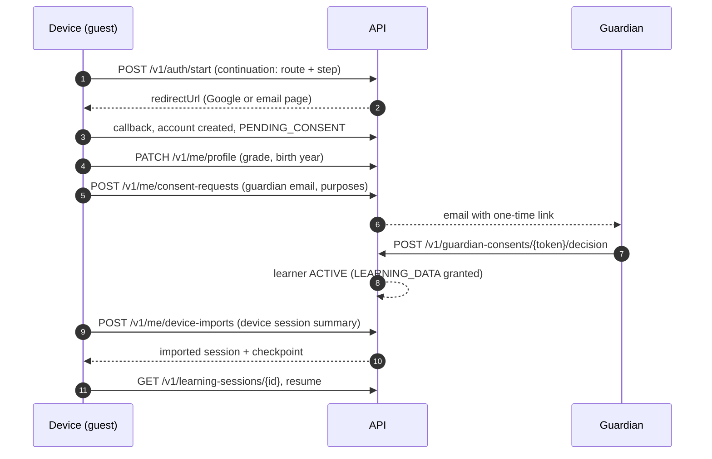

# 08 · Authentication, security and privacy

**This is an engineering reading of the sources listed in §7, not legal advice.** Every item marked *legal review* must be confirmed by Indonesian counsel before launch.

Starting point: IntiBelajar serves SMP and SMA students, so nearly every user is a **child** under Indonesian law (under 18). The design therefore treats **every learner as a child**, whatever age they declare, until verified otherwise (PP 17/2025 Pasal 22(4), §7).

## 1. Principals and threats

| Principal | Identified by | Typical actions |
|---|---|---|
| Device guest | Nothing on the server | Browse the public catalog, try public practice items on the device ([§5](#5-device-guest-to-account-migration)) |
| Learner | `app_user` (role `STUDENT`) → `learner` | Learning commands, tutor, intake, own progress, own data rights |
| Guardian | `app_user` (role `GUARDIAN`) → `guardian`, or a one-time consent link | Grant, decline or revoke consent; request deletion; see consent status |
| Staff | Workforce identity provider with MFA, in a separate admin tool | Publish content, review disputes, support with audited access |
| System | Worker and sweepers | Jobs, projections, retention, erasure |

Threats this design addresses, with the controls in this document:

- account takeover and session theft;
- cross-site request forgery, including against the legacy facade, which sends no CSRF token;
- broken object-level authorization (one learner reading another's session);
- scraping answer keys from public endpoints;
- abuse of AI cost;
- prompt injection ([07 §6.3](07-ai-integration.md#63-context-isolation-and-prompt-injection-resistance));
- over-collection of children's data and leaks through logs;
- insider access;
- open redirects through the login continuation.

## 2. Who can do what

### 2.1 Capability matrix

| Capability | Device guest | Learner `PENDING_CONSENT` | Learner `ACTIVE` | Guardian | Staff |
|---|---|---|---|---|---|
| Read public catalog (subjects, topics, concepts, public questions, lessons) | Yes | Yes | Yes | Yes | Yes |
| Stateless evaluation of public practice items (`POST /v1/public/evaluations`) | Only in `OPEN_TRIAL` mode (§2.2) | Same | Not needed | — | — |
| Start sign-in (`POST /v1/auth/start`) | Yes | — | — | Yes | — |
| Onboarding profile, consent request | — | Yes | Yes | — | — |
| Learning sessions, attempts, hints, lessons, progress | — | **No** (`403 CONSENT_REQUIRED`) | Yes, with `LEARNING_DATA` | — | — |
| AI diagnosis, tutor | — | No | With `AI_PROCESSING` | — | — |
| Photo intake | — | No | With `IMAGE_UPLOAD` **and** `AI_PROCESSING` | — | — |
| Device-history import | — | No | Yes, once per device session | — | — |
| Revoke optional purposes | — | — | Yes (only reduces processing) | Yes | — |
| Grant purposes | — | — | — | Yes | — |
| Request deletion | — | Yes | Yes | Yes, for linked learners | On a verified request only |
| See a learner's answers | — | Own | Own | **No**. Consent status and a progress summary only (proposed, [12](12-implementation-roadmap.md)). | Only through the dispute queue or audited support access |

### 2.2 Guest evaluation mode (`guest.evaluationMode`)

Blueprint D02: guests may try questions, but **their progress is not saved**. Two modes are designed. The choice needs *legal review*:

| Mode | What reaches the server | Behaviour |
|---|---|---|
| `CONSENT_FIRST` (**default until legal sign-off**) | Nothing from guests | Guests use the on-device evaluator for public practice items, as today. `POST /v1/public/evaluations` returns `403 FEATURE_DISABLED`. |
| `OPEN_TRIAL` | One answer to one public practice item, per request | Deterministic evaluation only. Nothing is stored, no AI is called, and the answer text is never logged. Rate-limited per IP address with in-memory counters. The response may include the item's key (INV-05 exception), because public practice items are not assessment items. |

In both modes, guest data never becomes evidence, and the guest's device keeps its own history ([§5](#5-device-guest-to-account-migration)).

### 2.3 Authorization rules

1. **Ownership comes from the session, never from the request.** Every learner-scoped query filters on the `learner_id` of the authenticated principal. A resource ID that belongs to someone else returns `404 NOT_FOUND`, the same as one that does not exist (INV-01). Client-sent `sessionId`, `learnerId` or `hintsUsed` are never authority.
2. **Status and consent are checked on every command**, inside the transaction:
   - learner `ACTIVE`, otherwise `403 ACCOUNT_UNAVAILABLE` (`SUSPENDED`, `DELETION_PENDING`) or `403 CONSENT_REQUIRED` (`PENDING_CONSENT`);
   - the purpose's consent `GRANTED`, otherwise `403 CONSENT_REQUIRED` with the missing purposes.
3. **Guardians** see only learners linked to them through a consent record they decided or were asked to decide. They never see answers, tutor messages or images.
4. **Staff** roles: `CONTENT_EDITOR`, `REVIEWER`, `SUPPORT`, `ADMIN`. Staff authenticate through the workforce identity provider with MFA. Access to learner data is per-record and reason-coded, written to `audit_event`, never bulk-exported. Production data is never copied to lower environments ([02 §7](02-system-architecture.md#7-deployment-topology)).
5. **Feature flags** gate AI, intake and the legacy facade. A disabled feature returns `403 FEATURE_DISABLED`.

## 3. Authentication

### 3.1 Students and guardians

| Method | Flow | Notes |
|---|---|---|
| Google | OpenID Connect authorization code flow with PKCE, `state` and `nonce` | The ID token's signature, `iss`, `aud`, `exp` and `nonce` are verified, and `email_verified` must be true. Identity key: `(GOOGLE, sub)`. |
| Email link | One-time token, 15 minutes, single use, stored hashed | For students and guardians without Google. The link opens an app page, and the token is consumed by a `POST`, so mail scanners that prefetch links cannot consume it. |

Sign-in sequence (blueprint A05):

1. `POST /v1/auth/start` (the shipped adapter's call) creates an anonymous pre-auth `auth_session` and an `auth_transaction` holding `state`, `nonce`, the PKCE verifier (encrypted) and the **continuation**. The continuation is an allow-listed app route plus an optional session ID and lesson step, never a free URL. The response is `{redirectUrl}`: Google's authorization URL, or the app's email page for the email method. That page sends the address with `POST /v1/auth/email/links`.
2. `GET /v1/auth/callback/google` (or `POST /v1/auth/email/verify`) checks the transaction against the pre-auth session, verifies the provider response, and finds or creates `auth_identity` → `app_user`.
3. **New student:** create a `learner` with status `PENDING_CONSENT` and `consent_deadline_at` = now + 7 days, then send the browser to onboarding.
4. **Rotate the session** (new token, old one revoked), consume the transaction, and redirect to the continuation route.

Account linking: a Google identity and an email identity are linked automatically only when both are verified for the same normalised address. Otherwise linking happens explicitly while signed in.

### 3.2 Sessions

- An opaque 256-bit random token in cookie `__Host-ib_session` (`Secure`, `HttpOnly`, `SameSite=Lax`, `Path=/`). The database stores only `SHA-256(token)` ([04 §2](04-postgresql-erd.md#2-identity-privacy-and-platform-tables)).
- Idle timeout 7 days, absolute lifetime 30 days (configurable; shared school devices are common, so "Keluar" is always one tap away). Rotation on sign-in and on any privilege change.
- `POST /v1/auth/logout` revokes the current session, and `?scope=all` revokes every session of the user. Deletion and consent revocation revoke all sessions immediately.

### 3.3 Onboarding and age assurance

- Onboarding asks for **grade** and **birth year**. The server derives `age_band` (`UNDER_13`, `AGE_13_15`, `AGE_16_17`, `ADULT`) and **does not store the birth year**. `age_band_source = SELF_DECLARED` until a guardian confirms it.
- PP 17/2025 requires a published minimum age and age verification (Pasal 2(4)). The proposed published minimum is 12 years (start of SMP), with guardian confirmation of the age band as the verification step. Both need *legal review* against Permenkomdigi 9/2026.
- **Every learner is treated as a child**, including those who declare 18 or more: they need guardian consent and get child defaults. Self-consent for verified adults is an open decision ([12](12-implementation-roadmap.md)).

## 4. Session cookies, CSRF and CORS

| Surface | Defence |
|---|---|
| Canonical `/v1` mutations | **Synchronizer token.** `GET /v1/auth/session` returns a `csrfToken` derived from the session's CSRF secret (stored hashed). Every `POST`, `PUT`, `PATCH` and `DELETE` must send it in `X-CSRF-Token`, or gets `403 CSRF_FAILED`. The `Origin` header must also match the app origin. |
| Legacy facade (`/v1/learning/*`, `POST /v1/auth/start`) | The shipped adapters send no token. Compensating checks: `Origin` present and exactly equal to an allowed origin, `Sec-Fetch-Site: same-origin` when the header is present, and `Content-Type: application/json` (so cross-origin requests need a CORS preflight, which is refused). Plus `SameSite=Lax`. The facade is removed when the frontend migrates ([09 §6](09-api-design.md#6-compatibility-with-the-current-frontend)). |
| Public endpoints (catalog, `public/evaluations`, guardian consent links) | No cookie authority. Consent links carry a one-time token. |
| CORS | Production is same-origin and sends no CORS headers. Development allows the named local origins (`http://localhost:5173`, `http://127.0.0.1:5173`) with credentials. Never `*`. |

Other headers: a strict Content Security Policy (`default-src 'self'`, no inline script, `frame-ancestors 'none'`), HSTS, `X-Content-Type-Options: nosniff`, `Referrer-Policy: no-referrer` on token pages and `strict-origin-when-cross-origin` elsewhere. Learner and AI text is rendered as text, never as HTML.

## 5. Device guest to account migration

Guests have **no server identity** (blueprint D02). Their history lives on the device, and the UI says so plainly: "Progres ini tersimpan di perangkat ini saja."

1. **While consent is pending,** the device keeps working in guest mode. Nothing is sent, and the app shows "Menunggu persetujuan orang tua". The pending account holds only the bootstrap data: the identity, the age band, the grade and the encrypted guardian email. It is erased if no decision arrives within 7 days ([04 §8](04-postgresql-erd.md#8-retention-and-deletion)).
2. **After consent,** the app offers "Simpan perjalanan dari perangkat ini?". On yes, it sends a minimal summary of each unfinished device session:
   - the device session ID;
   - the question alias;
   - the furthest step reached;
   - the learner's own answer text, only if the learner ticks "sertakan jawabanku".
3. The server creates an imported session ([05 §5.5](05-learning-state-machine.md#55-login-in-the-middle-of-a-loop-guest--account)). Imported answers are **never** evidence, XP or mastery (INV-21). A device session can be imported only once, by any account (`409 ALREADY_IMPORTED`), so a shared device cannot move one learner's history into another learner's account.
4. **Never imported:**
   - the beta identity in `intibelajar:beta-identity:v1` (name, class, WhatsApp number);
   - device XP, tiers, streaks and missions;
   - analytics events.
5. The device then marks its local copy as imported, so it is not offered again.

Blueprint A05's `409 GUEST_ALREADY_CLAIMED` has no server-side guest to protect here. Its role, preventing double attribution, is taken by `ALREADY_IMPORTED`.

## 6. Retention, deletion and learner rights

### 6.1 Consent

| Purpose | Covers | Default | Who grants |
|---|---|---|---|
| `LEARNING_DATA` | Storing sessions, answers, evidence, mastery and progress | Required for any server-side learning | Guardian |
| `AI_PROCESSING` | Sending redacted answers and tutor messages to the AI provider abroad (§7) | Off until granted | Guardian |
| `IMAGE_UPLOAD` | Uploading question photos for reading | Off until granted | Guardian |
| `PRODUCT_ANALYTICS` | Pseudonymous product analytics | Off until granted | Guardian |

- **Request:** `POST /v1/me/consent-requests` creates one `PENDING` record per purpose, stores the guardian email encrypted (with an HMAC for lookup), and emails a one-time link (valid 7 days).
- **Decision:** `GET /v1/guardian-consents/{token}` shows the exact policy text, purposes and the learner's nickname and grade. `POST …/decision` records each purpose with `decided_by = GUARDIAN`, the policy version and the SHA-256 of the text shown (INV-20). Declining `LEARNING_DATA` triggers erasure (reason `CONSENT_DECLINED`).
- **Method:** `GUARDIAN_EMAIL` by default. `GUARDIAN_SIGNIN` when the guardian has an account. `SELF_WITH_GUARDIAN_NOTICE` exists in the schema for older learners if counsel confirms that PP 17/2025 allows it for this product's risk profile (*legal review*). It is off by default.
- **Revocation:** a guardian can revoke any purpose (`POST /v1/guardian/learners/{learnerId}/consents/{purpose}/revocation`). A learner can revoke optional purposes themselves (`POST /v1/me/consents/{purpose}/revocation`), because revoking only reduces processing. Processing stops immediately (INV-20, [05 §5.6](05-learning-state-machine.md#56-other-interruptions)). Revoking `LEARNING_DATA` deletes the account's learning data, and the UI says so before confirming.
- **Policy changes:** a material change to a consent text sets affected learners to `SUSPENDED` until a guardian accepts the new version.

### 6.2 Retention and deletion

Retention periods are in [04 §8](04-postgresql-erd.md#8-retention-and-deletion) (proposed defaults, *legal review*). In short:

- raw answer text 180 days;
- tutor messages 30 days after the conversation closes;
- intake images deleted after reading;
- evidence and mastery while the account is active;
- inactive accounts erased after 13 months, with a notice at 12 months.

Deletion:

- `DELETE /v1/me` (learner) or `POST /v1/guardian/learners/{learnerId}/deletion-requests` (guardian) → `202`, learner `DELETION_PENDING`, every session revoked, processing stopped, all in one transaction. The erasure job completes within 7 days and leaves only a non-identifying receipt (INV-19).
- The guardian and the learner are notified when the deletion completes. UU 27/2022 Pasal 45 requires notifying the data subject of deletion (§7).
- Backups expire within 35 days. After any restore, erasure receipts are replayed before traffic is served.

### 6.3 Access and correction

- Learners see their own data in the app: progress, history, diagnoses, consent status.
- A full export is fulfilled through a verified support request in v1, and becomes self-service later ([12](12-implementation-roadmap.md)).
- Profile fields can be corrected in the app. Diagnoses are disputed through "Hasil keliru? Laporkan" ([06 §9.3](06-diagnosis-evidence-mastery.md#93-disputes-hasil-keliru-laporkan)).

### 6.4 Profiling safeguards

PP 17/2025 prohibits profiling children, with exceptions that include a feature the child requests and the child's best interest, with safeguards (Pasal 19, §7). Diagnosis is the feature the learner asks for when they submit an answer. Its safeguards are:

- **narrow purpose:** evidence is used only for the learner's own learning path, never for advertising, ranking, sharing or sale;
- **transparency:** every diagnosis explains what the answer showed ([06 §2.6](06-diagnosis-evidence-mastery.md#26-what-learner-facing-explanations-may-say));
- **human review:** disputes go to staff;
- **minimisation:** raw text expires, AI evidence never decides mastery;
- **control:** AI can be switched off by revoking `AI_PROCESSING`, while learning continues deterministically;
- **no precise geolocation:** intake images are re-encoded server-side, which strips EXIF metadata including GPS (Pasal 7(2) and Pasal 18).

### 6.5 Accountability (launch gates)

These are **launch gates**, not post-launch tasks:

1. a data protection impact assessment;
2. the data protection officer question settled (UU 27/2022 Pasal 53; PP 17/2025 Pasal 7(1));
3. the PP 17/2025 risk self-assessment (Pasal 5);
4. a child-friendly privacy notice and a guardian version;
5. a published minimum age;
6. approved consent texts;
7. the AI disclosure in the UI;
8. a data processing agreement with the AI provider;
9. a tested breach runbook. The runbook notifies data subjects and the authority **within 3 × 24 hours** (UU 27/2022 Pasal 46(1)).

## 7. Indonesian legal baseline (reviewed sources)

All sources accessed on 2026-10-17. **Limits are stated per source.** Nothing here was checked against an official gazette scan with certainty, so every row needs *legal review*.

| Source | How it was read | Provisions used | Limits |
|---|---|---|---|
| UU No. 27 Tahun 2022 tentang Pelindungan Data Pribadi | Wikisource transcription of the official text (pages with Pasal 4, 25, 45, 46, 53, 56). The official PDF on the government site is a scanned image that could not be read with the available tools. | Pasal 4(2)(e): children's data is *specific* personal data. Pasal 25(1)–(2): processing children's data is carried out specially and requires consent of the parent and/or guardian. Pasal 45: notify the data subject of deletion. Pasal 46(1): breach notice to the data subject and the authority within 3 × 24 hours. Pasal 53: data protection officer. Pasal 56: transfer abroad (equal or higher protection, else adequate and binding safeguards, else the data subject's consent). | Unofficial transcription. Hukumonline reports that Pasal 56 is under Constitutional Court review (cases 135 and 137/PUU-XXIII/2025). Other articles were not reviewed and are not relied on. |
| PP No. 17 Tahun 2025 (PP Tunas) on governance of electronic systems for child protection | pasal.id, an OCR-based aggregator. Official copy to verify: `peraturan.bpk.go.id/Details/316698`. | Pasal 1: child = under 18. Pasal 2(4): minimum age, age verification, reporting. Pasal 4: applies to products designed for or likely accessed by children. Pasal 5: risk self-assessment. Pasal 7: parental consent, DPIA and DPO; no covert practices, no precise geolocation, no profiling. Pasal 8: the child's best interest over commercial interest. Pasal 9: parental consent before use; refusal means no service and deletion. Pasal 10: high privacy by default. Pasal 11–13: clear information, education, notice of monitoring. Pasal 16: contractors comply. Pasal 17: no manipulative design. Pasal 18: geolocation. Pasal 19: profiling ban and its exceptions. Pasal 20(2): age bands. Pasal 21: account rules by age band, parental supervision tools. Pasal 22(4): without verified age, protect everyone as a child. Pasal 23: rights and complaint tools. Pasal 49: comply within 2 years of 27 March 2025. | OCR text from an aggregator, not the official copy. Article numbering and wording must be checked. |
| Permenkomdigi No. 9 Tahun 2026 (implementing regulation) | **Not read.** Known only from news coverage. | Reported to set age bands and self-assessment details | Must be obtained and reviewed. Minimum age, verification method and self-assessment format may change. |
| Anthropic, "Responsible use … organizations serving minors" (`support.claude.com/en/articles/9307344`) | Read directly (updated 16 March 2026) | Required: comply with child-safety and privacy law and state it publicly; disclose AI interaction. Recommended: age verification, moderation, monitoring and reporting, education, child-safety system prompt. | Policy can change. Re-check before launch. |

How the design responds:

| Legal point | Design element |
|---|---|
| Children's data needs parental consent (UU 27/2022 Pasal 25; PP 17/2025 Pasal 9) | No server-side learning data or AI before guardian consent. Slice 0 comes first ([12](12-implementation-roadmap.md)). |
| Everyone protected as a child without verified age (PP 17/2025 Pasal 22(4)) | All learners get child defaults |
| High privacy by default (Pasal 10), no manipulative design (Pasal 17) | Optional purposes off; no leaderboards, lives or guilt notifications; no dark-pattern consent screens |
| Profiling exception with safeguards (Pasal 19) | §6.4 |
| Transfer abroad (UU 27/2022 Pasal 56) | AI provider named in the consent text, a data processing agreement, the DPIA ([07 §6.4](07-ai-integration.md#64-cross-border-processing)) |
| Breach notice within 3 × 24 hours (Pasal 46) | Breach runbook as a launch gate |
| Notify on deletion (Pasal 45) | Deletion-complete notice to learner and guardian |
| Compliance deadline (PP 17/2025 Pasal 49) | Launch plan must meet it ([12](12-implementation-roadmap.md)) |

## 8. Application security controls

| Area | Control |
|---|---|
| Input | Strict JSON Schemas with `additionalProperties: false`. Body ≤ 64 KB (uploads ≤ 5 MB). Answer text ≤ 2,000 characters, tutor messages ≤ 500. Unknown fields rejected. |
| Output | Vue text interpolation only for learner and AI text (no `v-html`). Errors never echo input. |
| Uploads | Allow-list `image/jpeg`, `image/png`, `image/webp`, checked by magic bytes, not the header. Quarantine, decode and re-encode server-side (this strips metadata), size and pixel limits. Private bucket, random keys, short-lived signed reads for the worker only. |
| Answer keys | Never in canonical learner responses (INV-05). Public practice keys only through `OPEN_TRIAL`, rate-limited. Catalog questions are served without rubrics. |
| Rate limits | Auth start and email links: 5 per hour per address, 20 per hour per IP. Attempts: 30 per minute per learner. Tutor and intake: [07 §7.5](07-ai-integration.md#75-limits) and [07 §9](07-ai-integration.md#9-budgets-rate-limits-and-observability). Public evaluations: 30 per minute per IP. |
| Secrets | Cloud secret manager. Separate DB roles for migration, API and worker. No secret in `VITE_*`. |
| Encryption | Managed encryption at rest. Guardian and identity emails envelope-encrypted, with HMAC lookup columns and key rotation. TLS everywhere. |
| Supply chain | Locked dependencies, automated vulnerability scanning, pinned container base images |
| Logging | No answer text, tutor text, images, emails, names, tokens or provider payloads in logs ([02 §8](02-system-architecture.md#8-observability-without-personal-data)) |
| Testing | Authorization and CSRF tests per endpoint ([11](11-test-matrix.md)), and an external penetration test of sign-in, consent and learner endpoints before launch |
