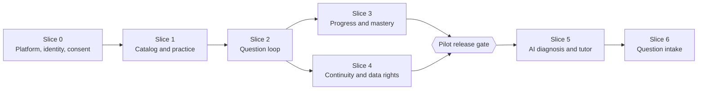

# 12 · Implementation roadmap

**Nothing here starts before this specification is reviewed.** Slices are vertical: each ships migrations, endpoints, frontend integration and tests together, and each has an exit gate. No dates are given, because no estimate has been validated with the team.

## 1. Order, and why it differs from a feature order

The brief allows reordering. This plan reorders on purpose:

1. **A new Slice 0 comes first.** The users are children. Storing their learning data, or sending it to an AI provider, needs verified parental consent (UU 27/2022 Pasal 25; PP 17/2025 Pasal 9; [08 §7](08-auth-security-privacy.md#7-indonesian-legal-baseline-reviewed-sources)). No slice that persists learner data can ship before identity and consent exist.
2. **Deterministic learning before AI.** Slices 1–4 deliver a complete product without any model call. AI needs a gold set and launch gates ([07 §8](07-ai-integration.md#8-evaluation-before-launch)), carries the highest risk for minors and cost, and must be switchable off without breaking learning.
3. **Progress (3) and continuity (4) run in parallel.** Both need only the question loop (2).
4. **The pilot release gate sits after Slices 3 and 4.** The pilot is the deterministic product with accounts, consent, progress and data rights.
5. **Intake comes last.** Photos of a child's surroundings, OCR and private questions carry the most privacy risk and depend on the AI gateway.

## 2. Slices

Migrations per slice are listed in [04 §9](04-postgresql-erd.md#9-migration-strategy). Endpoints refer to [09 §7](09-api-design.md#7-operation-catalogue).

### Slice 0 · Platform, identity and consent

| | |
|---|---|
| **Goal** | A student signs in, completes onboarding and obtains guardian consent. Nothing is learned on the server yet. The platform skeleton exists. |
| **Depends on** | Default decisions for OD-01 to OD-03 (§3), consent texts drafted for counsel |
| **Migrations** | `learner`, `guardian`, `app_user`, `auth_identity`, `auth_session`, `auth_transaction`, `student_profile`, `consent_record`, `deletion_request`, `erasure_receipt`, `audit_event`, `idempotency_record`, `job` |
| **Endpoints** | `GET /v1/auth/session`, `POST /v1/auth/start`, `GET /v1/auth/callback/{provider}`, `POST /v1/auth/email/links`, `POST /v1/auth/email/verify`, `POST /v1/auth/logout`, `GET`/`PATCH /v1/me/profile`, `GET /v1/me/consents`, `POST /v1/me/consent-requests`, `POST /v1/me/consents/{purpose}/revocation`, `DELETE /v1/me`, `GET /v1/guardian-consents/{token}`, `POST /v1/guardian-consents/{token}/decision`, `GET /v1/guardian/learners`, `POST /v1/guardian/learners/{learnerId}/consents/{purpose}/revocation`, `POST /v1/guardian/learners/{learnerId}/deletion-requests` |
| **Platform** | Fastify API and worker shell, migration runner (OD-15), CI (lint, types, tests, migration tests, `validate-spec.py`), OpenTelemetry, configuration flags, secrets, staging with synthetic data only |
| **Frontend** | `AccountOffer` already calls `/v1/auth/start`. Add the callback landing route, onboarding (S10) → profile, the "Menunggu persetujuan orang tua" state, the guardian consent page (public route), and a shared fetch wrapper that sends `X-CSRF-Token` and `Idempotency-Key`. Guest copy: "Progres ini tersimpan di perangkat ini saja." |
| **Tests** | INV-01, INV-02, INV-14, INV-19 (for the slice's tables), INV-20; sign-in flows; CSRF matrix; open-redirect; rate limits; link expiry; erasure of a pending learner after 7 days |
| **Exit** | A synthetic guardian approves on staging. No learning endpoint exists. DPIA drafted. Consent texts reviewed by counsel. |

### Slice 1 · Catalog and deterministic practice

| | |
|---|---|
| **Goal** | Practice sets and concept lessons run on the server, with answer keys held server-side |
| **Depends on** | Slice 0; the reviewed alias manifest ([03 §3](03-domain-model.md#3-identifiers)); the seed through the publisher ([04 §9](04-postgresql-erd.md#9-migration-strategy)) |
| **Migrations** | Catalog tables, `learning_session`, `session_item`, `lesson_assignment`, `question_attempt`, `assistance_event`, `diagnosis_run`, `concept_evidence` |
| **Endpoints** | Catalog reads (`/v1/subjects`, `/v1/topics`, `/v1/topics/{topicId}`, `/v1/concepts`, `/v1/concepts/{conceptId}`, `/v1/questions`, `/v1/questions/{questionId}`, `/v1/lessons/{lessonId}`); `POST`/`GET /v1/learning-sessions` (`PRACTICE`); `GET /v1/learning-sessions/{sessionId}`; `…/attempts`, `…/quick-check-answers`, `…/actions`, `…/hints`, `…/checkpoint`; `GET /v1/attempts/{attemptId}`; `GET /v1/diagnosis-runs/{diagnosisRunId}`; `POST /v1/public/evaluations` (behind OD-01); facade L3 (`practice`, `check`) |
| **Frontend** | `PracticeRunView` and `CoreView` use the canonical API for signed-in learners. Answer keys for catalog items leave the bundle (public practice keys may stay for on-device guests). Requests send `Idempotency-Key` and `expectedStateVersion`. Playwright is installed. |
| **Tests** | E-02, E-11–E-15, E-22–E-26; INV-04 to INV-07, INV-12, INV-14, INV-16, INV-17; contract validation; facade responses pass the frontend's validators |
| **Exit** | A practice session survives refresh and a second tab. No key appears in a learner response. The publisher accepts the seeded catalog (aliases unique, hard edges acyclic). |

### Slice 2 · The question loop

| | |
|---|---|
| **Goal** | `/coba` and `/challenge` run the full authoritative loop with deterministic diagnosis |
| **Depends on** | Slice 1 |
| **Migrations** | `diagnosis_report`; `job.diagnosis_run_id` |
| **Endpoints** | `QUESTION_LOOP` sessions; `POST /v1/attempts/{attemptId}/diagnosis`; `POST`/`GET …/solution`; `POST /v1/diagnosis-runs/{diagnosisRunId}/reports`; facade L1, L2, L4, L6 (authored ladder), L8 (keyword mapper); L5 continuation |
| **Evaluators** | `tower-v1`, ported from `services/analysis.ts`, whose branches become golden tests; option and numeric evaluators with misconception maps |
| **Frontend** | "Saya tahu caranya" leads to a clarification (OD-11). Retry and solution follow server state. "Hasil keliru? Laporkan" is wired. Polling already honours `Retry-After`. Legacy calls move to canonical endpoints one by one. |
| **Tests** | E-01, E-03–E-10, E-16–E-21; T01-1 to T01-7, T01-9, T01-11, T01-12; INV-08, INV-09, INV-13, INV-16, INV-22; lease recovery |
| **Exit** | Those T01 scenarios pass in CI against PostgreSQL |

### Slice 3 · Progress, mastery and gamification

| | |
|---|---|
| **Goal** | Map, Home, Progress and Profile read server projections only |
| **Depends on** | Slice 2 |
| **Migrations** | `mastery_state`, `progress_event`, `learner_stats`, rebuilt from existing evidence, so learners from Slices 1–2 lose nothing |
| **Endpoints** | `GET /v1/me/progress` (L9), `GET /v1/me/mastery`, `GET /v1/me/mastery/{conceptId}`, `GET /v1/me/progress-events`, `GET /v1/me/stats`; nightly projection job (`STALE_14D`) |
| **Frontend** | `useLearnerProgress` already reads L9. Map and Home move to `/v1/me/mastery` and `/v1/me/stats`. Client-side XP awarding stops for signed-in learners. Tier copy changes (OD-18): "Benar di soal baru tanpa bantuan" and "3 soal baru berturut-turut, salah satunya di sesi lain ≥24 jam kemudian". |
| **Tests** | INV-11, INV-15; T01-8; T02 Map/Home rows; all six XP rules; streak by timezone |
| **Exit** | Map and Home agree for 1,000 random histories; rebuild equals incremental |

### Slice 4 · Account continuity and data rights (parallel with Slice 3)

| | |
|---|---|
| **Goal** | Sign in mid-loop and continue; import device history; complete data rights |
| **Depends on** | Slices 0 and 2 |
| **Migrations** | None. New jobs run over existing tables. |
| **Endpoints** | `POST /v1/me/device-imports`; continuation resume through the existing sign-in endpoints; retention jobs (180-day answer-text purge, inactivity notice and erasure); support-assisted export; guardian progress summary if OD-13 is approved |
| **Frontend** | Device persistence that survives a browser restart (T02). "Simpan perjalanan dari perangkat ini?". Resume at the checkpoint after sign-in. Consent status, revocation and account deletion screens. |
| **Tests** | T01-10; T02 Resume and Claim rows; T02-E2E (deterministic part); INV-19 over all tables; INV-21; retention jobs |
| **Exit** | See the pilot gate below |

### Pilot release gate (after Slices 3 and 4)

- T01 Go/No-Go passes ([11 §3.1](11-test-matrix.md#31-t01-the-12-mandatory-backend-scenarios-and-gono-go)).
- T02-E2E passes.
- The privacy launch gates in [08 §6.5](08-auth-security-privacy.md#65-accountability-launch-gates) are complete, including counsel's review of OD-01 to OD-05.
- Load test at the pilot targets, and the external penetration test with findings fixed.
- The facade is monitored, with per-call usage visible, so each legacy call can be retired.

### Slice 5 · AI diagnosis assistance and IntiBot

| | |
|---|---|
| **Goal** | AI-assisted diagnosis of free text and the AI tutor, behind flags, for learners with `AI_PROCESSING` consent |
| **Depends on** | The pilot gate; OD-06 to OD-10; the gold set |
| **Migrations** | `tutor_conversation`, `tutor_message`, `ai_invocation`, `budget_counter`; `job.tutor_message_id` |
| **Endpoints** | `POST /v1/tutor-conversations`, `GET /v1/tutor-conversations/{conversationId}`, `POST /v1/tutor-conversations/{conversationId}/messages`, `GET /v1/tutor-messages/{messageId}`; the AI engine joins the diagnosis pipeline (no new endpoint); budgets answer `429 AI_BUDGET_EXCEEDED` |
| **Frontend** | **Required before enabling:** the "IntiBot adalah AI" label and first message, and the "Dianalisis dengan bantuan AI" badge. The tutor becomes asynchronous (`202` + polling) instead of the synchronous L6 call. A plain request for `AI_PROCESSING` consent, without dark patterns. |
| **Tests** | The gates in 07 §8; INV-03, INV-10, INV-18; circuit breaker; budget races; injection suite |
| **Exit** | Gold-set gates pass. Switching AI off leaves deterministic learning intact. |

### Slice 6 · Question intake (Tanya soal)

| | |
|---|---|
| **Goal** | Learners photograph or type their own question, confirm it, and run the loop on it |
| **Depends on** | Slice 5 (reading and mapping through the gateway); `IMAGE_UPLOAD` consent; object storage (ADR-07) |
| **Migrations** | `question_intake`, `private_asset`; `job.question_intake_id` |
| **Endpoints** | `POST /v1/question-intakes`, `GET`/`DELETE /v1/question-intakes/{intakeId}`, `PUT /v1/question-intakes/{intakeId}/image`, `POST /v1/question-intakes/{intakeId}/confirmation`; sessions with origin `INTAKE` |
| **Frontend** | `QuestionIntakeView` moves to the asynchronous flow (upload, poll, confirm). L7 and L8 are retired. |
| **Tests** | Upload security, metadata stripping, deletion within 24 hours, mapping validation, private-question ownership (INV-01), erasure including objects |
| **Exit** | No image outlives 24 hours. The facade has no remaining callers and is removed. |

## 3. Open decisions requiring approval

| ID | Decision | Default in this spec | Owner | Needed by |
|---|---|---|---|---|
| OD-01 | Guest evaluation mode: `CONSENT_FIRST` or `OPEN_TRIAL` ([08 §2.2](08-auth-security-privacy.md#22-guest-evaluation-mode-guestevaluationmode)) | `CONSENT_FIRST` | Counsel + product owner | Slice 1 |
| OD-02 | Published minimum age and age-verification method under PP 17/2025 and Permenkomdigi 9/2026 | 12 years; guardian confirms the age band | Counsel + product owner | Slice 0 |
| OD-03 | Self-consent with guardian notice for older learners; self-consent for verified adults | Off: guardian consent for everyone | Counsel | Slice 0 |
| OD-04 | Retention periods ([04 §8](04-postgresql-erd.md#8-retention-and-deletion)) | As proposed | Counsel | Slice 4 |
| OD-05 | DPIA owner, data protection officer, PP 17/2025 risk self-assessment | Launch gates | Management + counsel | Pilot gate |
| OD-06 | AI provider retention terms, zero-data-retention availability, processing agreement, Pasal 56 transfer basis (AI-1, AI-2) | AI off until settled | Counsel + engineering | Slice 5 |
| OD-07 | Model per purpose after the gold-set comparison (AI-3) | `claude-opus-5-5` everywhere | Product owner | Slice 5 |
| OD-08 | AI budget caps (AI-4) | 20 diagnoses, 60 tutor messages, 10 intakes per learner per day | Product owner | Slice 5 |
| OD-09 | Distress escalation protocol and verified help resources (AI-5) | Tutor stays off until approved | Child-protection advisers + counsel | Slice 5 |
| OD-10 | Real learner answers in the gold set (AI-6) | No: synthetic items only | Counsel + product owner | Slice 5 |
| OD-11 | "Saya tahu caranya" asks for a short proof instead of counting as correct ([05 §4.4](05-learning-state-machine.md#44-self-reported-responses)) | Ask for proof; no XP for a claim | Product owner | Slice 2 |
| OD-12 | Streak freezes | Off | Product owner | Slice 3 |
| OD-13 | What guardians may see (supervision tools, PP 17/2025 Pasal 21) | Consent status only; progress summary proposed | Product owner + counsel | Slice 4 |
| OD-14 | Cloud provider and exact Jakarta region; managed PostgreSQL vendor | Any of ADR-10's options | Engineering + finance | Slice 0 |
| OD-15 | Migration runner (`dbmate` or `node-pg-migrate`) | Either | Engineering | Slice 0 |
| OD-16 | Dispute review target and staffing | 5 school days | Product owner | Slice 2 |
| OD-17 | Session lifetimes on shared school devices | 7 days idle, 30 days absolute | Product owner + security | Slice 0 |
| OD-18 | K05 thresholds and tier copy (3/3, ≥ 2 contexts, ≥ 24 hours in another session) | As the blueprint | Content lead | Slice 3 |
| OD-19 | Launch timing against the PP 17/2025 compliance deadline (2 years from 27 March 2025) | Plan the pilot gate before it | Management | Now |

## 4. Assumptions

- Pilot scale as in [02 §6](02-system-architecture.md#6-non-functional-targets-provisional). The targets are design targets, not measurements.
- A managed container platform and managed PostgreSQL are available in a Jakarta region at acceptable cost (OD-14).
- Google sign-in is acceptable for the audience. Learners without a usable Google account use the email link; Google's own policies for young users are outside this design.
- The content team can review the alias manifest, write rubrics with solution paths and misconception maps, and label the gold set.
- Staff can review disputes within the target (OD-16).
- The shipped frontend's L1–L9 adapters remain in production until each call migrates; the facade exists for that window only.
